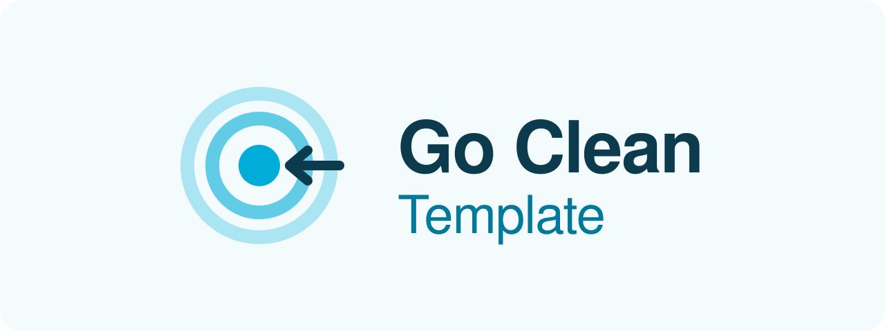
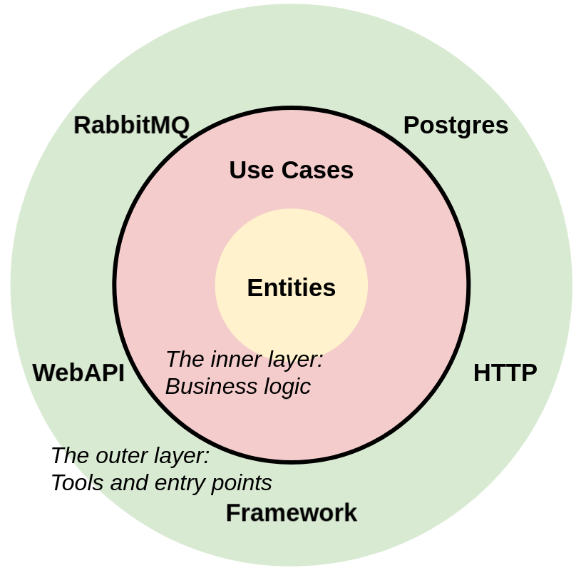

# Go Clean template

A Go service laid out with Clean Architecture: three domains behind one use-case layer that every
transport shares.

[](go.mod)
[](LICENSE)
[](https://github.com/m7medVision/go-clean-template/releases)

Forked from [evrone/go-clean-template](https://github.com/evrone/go-clean-template).

## What you get

- **CQRS with event sourcing.** Every change is a command and every read a query, sent through
  typed buses. The stored truth is the events each aggregate records; the tables queries read are
  projections of them.
- **One set of commands and queries under every transport:**
  - REST ([chi](https://github.com/go-chi/chi) + [Huma](https://github.com/danielgtaylor/huma),
    OpenAPI generated from the code).
  - gRPC.
  - GraphQL ([gqlgen](https://github.com/99designs/gqlgen)).
- **Three domains.** User auth (JWT), tasks with a status state machine, and currency exchange
  against an outbound HTTP API.
- **Passkeys alongside passwords.** Add one from the profile, sign in with it from a button or the
  browser's autofill; each sign-in challenge works once.
- **Roles** carried in the auth token and checked once, on the buses, for every transport.
- **SSO.** Sign in through any OpenID Connect provider (Keycloak ships ready in dev, with an admin
  and a user), with the provider's roles mapped to the app's.
- **Postgres and nothing else.** Typed queries with [sqlc](https://sqlc.dev/) and a declarative
  [Atlas](https://atlasgo.io/) schema applied at startup.
  The event store and the job queue are ordinary tables too.
- **A worker binary.** It runs the projections, and consumes that queue, starting from an example
  handler.
  It sends email from templates embedded in the binary.
- **A React client.** TanStack Router, Query, Table and Form, typed from the OpenAPI document and the
  GraphQL schema.
- **OpenTelemetry tracing** through every layer, Prometheus metrics, and a Caddy front end with a WAF.
- **Generated code wherever it can be:** SQL, mocks, protobuf, GraphQL, frontend types, and the
  OpenAPI document.
- **A domain and use-case generator.** `make new-domain` and `make new-usecase` write every layer and
  every transport's handlers and tests, with stub bodies for you to fill in, and check every edit
  before writing anything.

## Clean Architecture

The code is split into layers, and **dependencies only point inward**:



Inside the use-case layer, every change is a command and every read a query: controllers send them
through the buses, command handlers record events, and query handlers read projections.

These are rules, not suggestions: a change that breaks one is not merged.
[docs/architecture.md](docs/architecture.md) lists them with where each kind of code goes,
[docs/cqrs.md](docs/cqrs.md) explains the commands, events and projections, and
[docs/request-flow.md](docs/request-flow.md) follows one request through every layer.

## Quick start

Needs Docker, Go, `tmux` and `curl`.
The web client also needs the [Vite+](https://viteplus.dev/) `vp` CLI, and its dependencies installed once with `make web-deps`.

```sh
cp .env.example .env
make dev        # the app's dependencies in docker, everything else with hot reload
```

Then open:

- <http://localhost:3000>: the web client, where you register a user.
  **Sign in with SSO** as `alice` / `alice` to try the admin role.
- <http://127.0.0.1:8080/docs>: the REST API reference
- <http://127.0.0.1:8080/graphql/playground>: GraphQL
- <http://127.0.0.1:8025>: Mailpit, which catches the email the app sends

If Postgres already runs on the host's port 5432, set `PG_PORT=5433` in `.env` first.

## Docs

- [Architecture](docs/architecture.md): the rules, where code goes, packages, Clean Architecture
- [A request, end to end](docs/request-flow.md): one request through every layer, file by file
- [Generator](docs/generator.md): new domains and use cases, the safety rules, changing the templates
- [API](docs/api.md): every endpoint on every transport, errors, versioning
- [Development](docs/development.md): dev mode, tests, the full stack behind Caddy
- [Configuration](docs/configuration.md): every environment variable, tracing
- [Passkeys](docs/passkeys.md): the WebAuthn ceremonies, replay protection, relying-party setup
- [SSO and roles](docs/sso.md): OpenID Connect sign-in, the dev Keycloak, role mapping, other providers
- [Queue and worker](docs/worker.md)
- [Web client](docs/web.md)
- [Releases](docs/releasing.md): how versions are named from commits and what each release ships

## License

[MIT](LICENSE)
