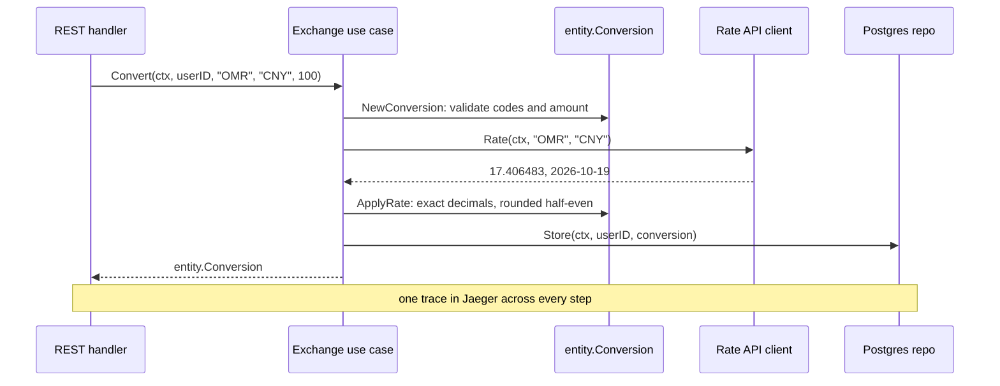

# Go Clean template

A Go service laid out with Clean Architecture: three domains, served over REST, gRPC and GraphQL from
one use-case layer, with a background worker and a React client.

[](go.mod)
[](LICENSE)

Forked from [evrone/go-clean-template](https://github.com/evrone/go-clean-template).


## What you get

- **Three transports, one use-case layer.** REST ([chi](https://github.com/go-chi/chi) +
  [Huma](https://github.com/danielgtaylor/huma), OpenAPI generated from the code), gRPC, and GraphQL
  ([gqlgen](https://github.com/99designs/gqlgen)).
- **Three domains.** User auth (JWT), tasks with a status state machine, and currency exchange
  against an outbound HTTP API.
- **Postgres and nothing else.** Typed queries with [sqlc](https://sqlc.dev/), a declarative
  [Atlas](https://atlasgo.io/) schema applied at startup, and a job queue in one ordinary table.
- **A worker binary.** It consumes that queue and sends email from templates embedded in the binary.
- **A React client.** TanStack Router, Query, Table and Form, typed from the OpenAPI document and the
  GraphQL schema.
- **OpenTelemetry tracing** through every layer, Prometheus metrics, and a Caddy front end with a WAF.
- **Generated code wherever it can be:** SQL, mocks, protobuf, GraphQL, OpenAPI, frontend types.

## How a request flows

`POST /v1/exchange/convert` with `{"from": "OMR", "to": "CNY", "amount": "100"}`:



1. [`restapi/v1/exchange.go`](internal/controller/restapi/v1/exchange.go) decodes a Huma-validated
   request DTO and maps domain errors to HTTP statuses. gRPC and GraphQL handlers call the same use case.
2. [`usecase/exchange/exchange.go`](internal/usecase/exchange/exchange.go) holds the rule. It knows only
   the interfaces in [`repo/contracts.go`](internal/repo/contracts.go).
3. [`entity/exchange.go`](internal/entity/exchange.go) owns validation and the decimal arithmetic.
4. [`webapi/exchange_openerapi.go`](internal/repo/webapi/exchange_openerapi.go) and
   [`persistent/exchange/exchange.go`](internal/repo/persistent/exchange/exchange.go) are the only code
   that knows about HTTP providers and SQL.

## Quick start

Needs Docker, Go, `tmux`, `curl` and the [Vite+](https://viteplus.dev/) `vp` CLI.

```sh
cp .env.example .env
make web-deps   # frontend dependencies, once
make dev        # Postgres + Mailpit in docker; app, worker and web client with hot reload
```

Then open:

- http://localhost:3000: the web client (register a user to start)
- http://127.0.0.1:8080/docs: the REST API reference
- http://127.0.0.1:8080/graphql/playground: GraphQL
- http://127.0.0.1:8025: Mailpit, which catches the welcome email

If Postgres already runs on the host's port 5432, set `PG_PORT=5433` in `.env` first.

## Docs

- [Architecture](docs/architecture.md): the dependency rule, packages, Clean Architecture
- [API](docs/api.md): every endpoint on every transport, errors, versioning
- [Development](docs/development.md): dev mode, tests, the full stack behind Caddy
- [Configuration](docs/configuration.md): every environment variable, tracing
- [Queue, worker and email](docs/worker.md)
- [Web client](docs/web.md)

## License

[MIT](LICENSE)
