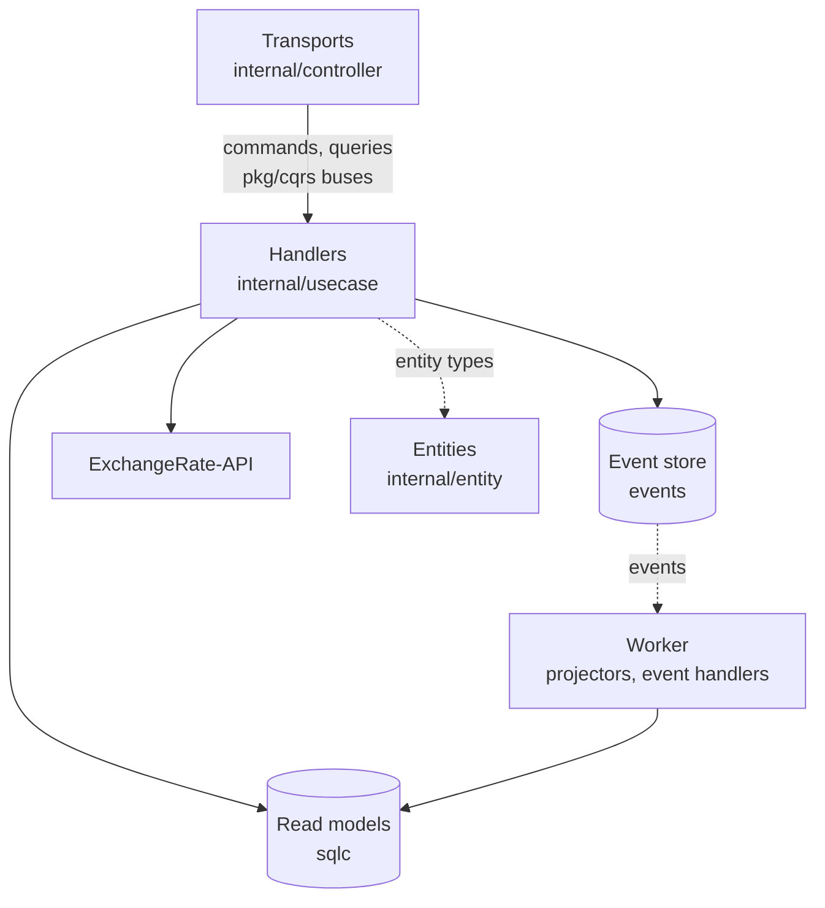
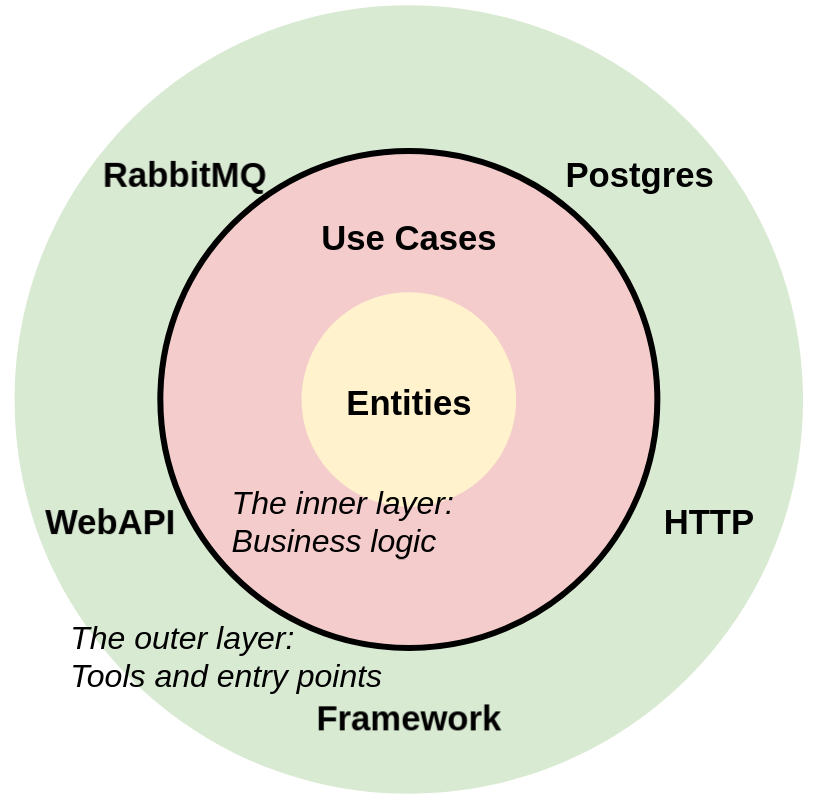
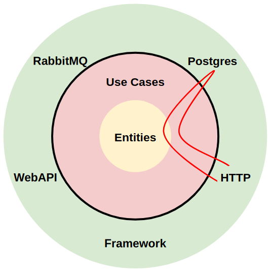
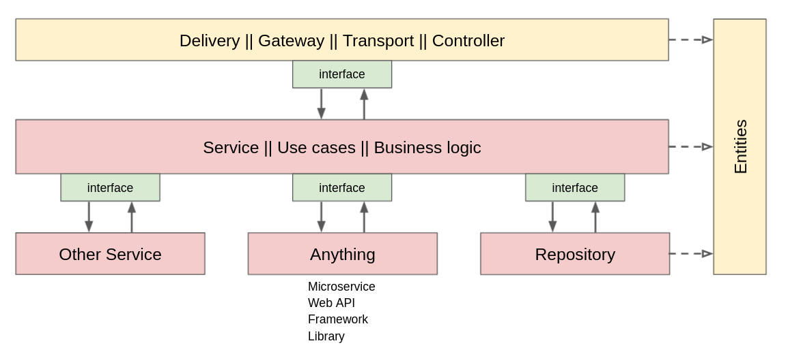

# Architecture

How the template is layered, the rules that keep it that way, and which package holds what. Every
change follows the [rules](#rules) below; a change that breaks one is not merged, however small.
[request-flow.md](request-flow.md) shows the rules at work on one real request.

## The dependency rule

Dependencies point inward. Controllers send commands and queries through the buses in
[`pkg/cqrs`](../pkg/cqrs) to their handlers in `internal/usecase/<domain>/command/` and `query/`.
Handlers reach storage and outbound APIs through the interfaces in
[`internal/repo/contracts.go`](../internal/repo/contracts.go): the event store for writes, a read
model for reads. Every layer passes [`internal/entity`](../internal/entity) types, and `entity` imports
nothing from this module. [cqrs.md](cqrs.md) explains the command and query split and the event store.



The queue worker (`cmd/worker`) runs the projectors that keep the read models up to date from the
events, and the event handlers that react to them. It also consumes the `queue_messages` table:
its handlers in `internal/controller/worker` send commands on the same command bus, such as
`DeliverEmail`, which renders the mail templates and sends over SMTP.

Each transport is a controller package: [the packages table](#packages) lists them.
Controllers never import each other, and none of them knows about Postgres. A REST handler that needs
data sends a query, whose handler goes through a read-model interface. `pkg/` holds infrastructure
with no domain knowledge (buses, servers, logger, JWT, Postgres pool, tracing and the like) and must
not import `internal/`.

## Rules

Clean Architecture only pays off while it stays clean. One shortcut, such as a handler that runs a query
"just this once", is copied by the next change, and in a few months the layers mean nothing. So these
are rules, not guidelines. When a rule gets in the way, the design is what has to change, not the rule.

### Dependencies

1. **Imports point inward only:** controller → command and query types → handlers → repo
   interfaces → entity. An inner layer never imports an outer one.
2. **`internal/entity` imports nothing from this module.** Domain types, aggregates, events and
   their rules are plain Go.
3. **Handlers know only interfaces.** They depend on `internal/repo/contracts.go`, never on a
   repository implementation, and import no HTTP client, SQL driver or transport framework.
4. **Controllers send messages, never call repositories.** No SQL, no `pkg/postgres`, no outbound
   HTTP in a controller: it sends a command or a query on the buses.
5. **Transports are independent.** The packages under `internal/controller/` never import each other.
   Logic two transports share belongs in a handler. Inside a transport, the domain folders
   (`restapi/v1/task`, `grpc/v1/task`, `graphql/task`, …) never import each other either; what
   several domains share has its own package in that transport (`restapi/v1/response`,
   `restapi/v1/apidoc`, `restapi/v1/apierr`, `grpc/v1/rpcerr`, `graphql/middleware`, `graphql/gqlerr`,
   `graphql/paging`).
6. **`pkg/` never imports `internal/` or `config/`.** It takes its settings as arguments.
7. **Wiring happens once,** in `internal/app`: `buses.go` builds the buses, registers every domain's
   handlers (`registerHandlers`) and lists the worker's subscribers. Nothing else constructs its own
   dependencies.

### Each layer's job

8. **A controller handler does six things, in order:** get the caller, decode into a transport-local
   DTO, validate structure, send the command or query with the request's `ctx`, map `entity.Err*`
   sentinels to a transport status, and encode a response DTO. Nothing else. It never passes a request
   DTO into a message, and returns an entity directly only when its JSON shape already is the API shape.
9. **A domain rule is written once, on the aggregate or in the handler.** Never in a controller, and
   never duplicated per transport. A rule about one record goes on its aggregate
   (`TaskAggregate.Transition`, `entity.NewConversion`); a rule across records uses a claim
   (unique emails). Authorization is a domain rule too: "only an admin lists every user's tasks" is
   `ListAllTasks.RequiredRole`, enforced by the buses' authorize step for every transport.
10. **State changes only through aggregates recording events.** A command handler loads an
    aggregate, calls its behavior method and saves what it recorded. A command returns what
    identifies the write (`cqrs.Written`), never resource data; a query reads only read models; and
    only a read model's projector writes its tables.
11. **Only controllers know transport errors.** Lower layers return sentinels from
    `internal/entity/errors.go` or errors wrapped with their layer path
    (`fmt.Errorf("CreateTask - aggregate.Create: %w", err)`).
12. **Cross-cutting concerns are steps, not decorators.** Tracing, logging, metrics, retries,
    authorization and validation wrap every message on the buses (`pkg/cqrs`,
    `internal/usecase/behavior`), so no handler carries them. Repositories still return their
    interface wrapped in a tracing decorator (`tracing.go`).

### Where code goes

Ask what the code knows about:

| The code knows about… | It goes in |
| --- | --- |
| nothing but the domain | `internal/entity/<name>.go`; its aggregate in `<name>_aggregate.go`, its events in `<name>_events.go` |
| one change a user asks for | a command: `internal/usecase/<domain>/command/<name>.go` |
| one thing a user reads | a query: `internal/usecase/<domain>/query/<name>.go` |
| a side effect that follows an event | an event handler: `internal/usecase/<domain>/event/<name>.go` |
| SQL | `internal/repo/persistent/queries/<domain>.sql`, then `make sqlc` |
| a read-model table, or how events change it | `internal/repo/persistent/<domain>/` (`<domain>.go`, `projector.go`) |
| an outbound HTTP API | `internal/repo/webapi/<name>.go` |
| a transport status or error code | `internal/controller/<transport>/v1/<domain>/` (GraphQL: `internal/controller/graphql/<domain>/`) |
| a queue message | `internal/controller/worker/v1/<name>.go` |
| a server, client or middleware with no domain knowledge | `pkg/<name>/` |

If the code knows about two of these, it is two pieces of code in two layers.

### Reviewing a change

A reviewer checks the imports first:

- Does any `internal/entity` or `internal/usecase` file gain an import of a driver, a transport or a
  repository implementation?
- Does a controller import `internal/repo`, or another controller?
- Is there an `if` about the domain (status, ownership, currency) in a controller?
- Does a query load an aggregate, or a command return resource data?
- Does anything but a projector write a read-model table?
- Is a new message missing from its domain's `register.go`, or a new event from `EventTypes()`?
- Is a new repository contract method missing from its `tracing.go` decorator or from the mocks
  (`make mock`)?

Any "yes" is a rule broken, and the change goes back.

## Roles

The app knows two roles, `entity.RoleAdmin` and `entity.RoleUser`. A sign-in writes the caller's
roles into the app JWT (`roles` claim). A password sign-in always grants `user` (`entity.LocalRoles`).
A passkey sign-in does too.
An SSO sign-in grants the roles the provider's claims map to ([sso.md](sso.md#roles)).
Each transport's auth turns the token into an `entity.Principal`, dropping role names it does not
know:

- REST: `middleware.Principal`
- gRPC: `grpcmw.PrincipalFromContext`
- GraphQL: `middleware.Principal` (in `graphql/middleware`)

A handler puts the
principal in the messages that need a role, such as `ListAllTasks`: the buses' authorize step
answers `entity.ErrAdminRequired` to anyone without `admin`. Every other message takes the plain
user ID. Roles are fixed when the token is issued, so a change takes effect at the next sign-in.

## Packages

| Package | What it holds |
| --- | --- |
| [`cmd/app`](../cmd/app/main.go) | Reads config, builds the logger, then hands over to `internal/app.Run`. |
| [`cmd/worker`](../cmd/worker/main.go) | Reads config, then `RunWorker` in `internal/app/worker.go`. Same Docker image as the app (`/worker` instead of `/app`); it never applies the schema. |
| [`cmd/openapi`](../cmd/openapi/main.go) | Prints the REST OpenAPI document without a server or database. `make openapi` writes it to `docs/openapi/v1.json`. |
| [`internal/app`](../internal/app) | Wiring. `buses.go` builds the command and query buses with their steps, registers every domain's handlers (`registerHandlers`) and lists the worker's projectors and event handlers (`subscribers`); `backfill.go` lists each domain's importer. `app.go` runs the backfill, starts the servers (`initServers`) and waits for a signal to shut down; `worker.go` runs the queue worker and the projection runner. See [Schema](#schema) for `migrate.go`. |
| [`internal/controller`](../internal/controller) | One package per transport. Inside each, one folder per domain (`restapi/v1/task/`, `grpc/v1/task/`, `graphql/task/`) holds that domain's handlers, request and response DTOs, and tests; the version's `router.go` registers every domain over the buses. Handlers decode, send a command or query, map `entity.Err*` sentinels to a transport status, and encode. |
| [`internal/controller/restapi`](../internal/controller/restapi) | REST: [chi](https://github.com/go-chi/chi) routes wrapped by [Huma](https://github.com/danielgtaylor/huma), which builds the OpenAPI document. `v1/response/` (`Token`), `v1/apidoc/` (the security scheme and the `auth` tag) and `v1/apierr/` (the failures any command can produce) are shared by several domains; `resttest/` is the test kit each domain's tests serve the router with, over fake handlers on real buses. |
| [`internal/controller/grpc`](../internal/controller/grpc) | gRPC, from the `.proto` files in `docs/proto`. Each domain folder's `New` returns its generated service interface, which `v1/router.go` registers; `v1/rpcerr/` maps the failures any command can produce. |
| [`internal/controller/graphql`](../internal/controller/graphql) | GraphQL: [gqlgen](https://github.com/99designs/gqlgen), mounted on the REST router. One folder per domain (`task/`, `exchange/`) holds its resolvers and their tests; `resolver.go` joins them into the root `Query` and `Mutation`. `middleware/` (the caller), `gqlerr/` (error codes) and `paging/` are shared, and `graphqltest/` is the test kit. gqlgen generates only `generated/` and `model/`. |
| [`internal/controller/worker`](../internal/controller/worker) | The queue worker's message handlers; the mail handler sends `DeliverEmail`. |
| [`internal/entity`](../internal/entity) | Domain types (the read shapes the API returns), the aggregates and their events, the claims, and sentinel errors. `EventTypes()` lists every event the store can decode. |
| [`internal/usecase`](../internal/usecase) | One package per domain: `command/` and `query/` hold one file per message with its handler, `event/` the event handlers, and `register.go` lists them. `aggregate/` is the load–change–save helper every command uses, and `behavior/` the app's pipeline steps (stamp, wait, retry, authorize, validate). See [cqrs.md](cqrs.md). |
| [`internal/usecase/passkey`](../internal/usecase/passkey) | WebAuthn registration and sign-in. `ceremony/` is the only package that imports [go-webauthn](https://github.com/go-webauthn/webauthn); it stores nothing, and the commands and queries pass it the browser's JSON as bytes. Ceremony state travels in a signed token and a login challenge is burned on finish. See [passkeys.md](passkeys.md). |
| [`internal/usecase/oidc`](../internal/usecase/oidc) | SSO sign-in through an OpenID Connect provider. `sso/` is the only package that imports [go-oidc](https://github.com/coreos/go-oidc) and `x/oauth2`; it maps the provider's role claim to app roles. `FinishOIDCLogin` finds the identity's user through its claim, or creates one. See [sso.md](sso.md). |
| [`internal/repo/persistent`](../internal/repo/persistent) | Postgres. Each domain's package holds its read model, its projector and its importer. SQL lives in `queries/*.sql` and [sqlc](https://sqlc.dev/) compiles it to typed Go; there is no ORM. `make sqlc` first renders the HCL schema to `queries/schema/schema.sql` with Atlas in a throwaway container, so it needs Docker. |
| [`internal/repo/persistent/eventstore`](../internal/repo/persistent/eventstore) | The event store: append under the store's lock with an optimistic version check, claims, snapshots, the codec and its upcasters, the reader the projection runner tails, and the backfill. |
| [`internal/repo/persistent/projection`](../internal/repo/persistent/projection) | The projection runner the worker runs (checkpoints, `LISTEN`, rebuild), the checkpoints the wait step reads, and the `projection_lag_events` collector. |
| [`internal/repo/memstore`](../internal/repo/memstore) and [`eventstoretest`](../internal/repo/eventstoretest) | An in-memory event store for command-handler tests, and the contract suite it and the Postgres store both pass. |
| [`internal/repo/repomock`](../internal/repo/repomock) | gomock mocks of `repo/contracts.go`, generated by `make mock`. |
| [`internal/repo/persistent/passkey`](../internal/repo/persistent/passkey) | The passkey read model (`webauthn_credentials`, the library's credential record in a `jsonb` column) and the burned login challenges (`webauthn_used_challenges`), a write-side guard: a burn that inserts no row is `entity.ErrPasskeyChallengeUsed`. |
| [`internal/repo/webapi`](../internal/repo/webapi) | Outbound HTTP. `exchange_openerapi.go` reads daily rates from open.er-api.com with plain `net/http`, decodes them straight into `decimal.Decimal`, and maps the provider's `unsupported-code` error (sent with HTTP 200) to `entity.ErrUnsupportedCurrency`. Its unit test serves the recorded response in `testdata/`. |
| [`internal/repo/mailtmpl`](../internal/repo/mailtmpl) | Email rendering. See [worker.md](worker.md). |
| [`internal/repo/notify`](../internal/repo/notify) | `repo.UserNotifier`: turns account events (the welcome) into emails on the mail queue, so the `SendWelcomeEmail` event handler knows nothing about queues or email encoding. |
| [`pkg/cqrs`](../pkg/cqrs) | The typed command and query buses, and the trace, log and metrics steps every message passes. |
| [`pkg/postgres`](../pkg/postgres) | The pool, and `InTx` and `Executor`: a transaction carried in the context, which every repository and the event store join. |
| [`pkg/jwt`](../pkg/jwt) | `Manager` signs and parses the auth JWT. `Scoped` signs short-lived payloads for one purpose, with a key derived from the same secret by HKDF and the purpose as audience, so neither token passes for the other; a sign-in flow that spans two requests keeps its state in one. The auth JWT carries a `roles` claim ([Roles](#roles)). |
| [`pkg/tracing`](../pkg/tracing) | OpenTelemetry setup; a no-op provider when tracing is off. See [configuration.md](configuration.md#tracing). |
| [`pkg/worker`](../pkg/worker) | The queue consumer. See [worker.md](worker.md). |
| [`pkg/smtp`](../pkg/smtp) | The SMTP client. See [worker.md](worker.md#smtp). |

### Schema

The schema is declarative: `internal/app/schema/*.hcl`, one file per table, embedded in the binary.
Built with the `migrate` tag (`make run`, `make dev` and the Dockerfile do this), the app diffs that
schema against its database at startup with [Atlas](https://atlasgo.io/) and makes the database match.
There are no migration files and no separate dev database. The apply creates what is missing **and
drops tables and columns the HCL does not declare**, so check `PG_URL` before starting the app.

```sh
go run -tags migrate ./cmd/app
```

## Dependency injection

To keep business logic independent of external packages, a handler declares what it needs as
interfaces, and receives the implementations as fields:

```go
package query

import (
	"context"

	"github.com/m7medvision/go-clean-template/internal/entity"
	"github.com/m7medvision/go-clean-template/internal/repo"
)

type GetTaskHandler struct {
	Tasks repo.TaskReadModel // an interface
}

func (h GetTaskHandler) Handle(ctx context.Context, q GetTask) (entity.Task, error) {
	return h.Tasks.Get(ctx, q.UserID, q.TaskID)
}
```

Each domain's `register.go` fills the fields in from the dependencies `internal/app` passes it, once.
Any implementation of the interface can replace another without a change to the handler. It also
makes the interfaces mockable: this repo generates gomock mocks from `internal/repo/contracts.go`
into `internal/repo/repomock` (`make mock`), and command handlers are tested against the in-memory
event store in `internal/repo/memstore`.

For a large number of injections, [wire](https://github.com/google/wire) can generate the wiring.

## Clean Architecture

### Key idea

Programmers realize the optimal architecture for an application after most of the code has been written.

> A good architecture allows decisions to be delayed to as late as possible.

### The main principle

Dependency Inversion (the same one from SOLID) is the principle of dependency injection.
The direction of dependencies goes from the outer layer to the inner layer.
Due to this, business logic and entities remain independent from other parts of the system.

So, the application is divided into 2 layers, internal and external:

1. **Business logic** (Go standard library).
2. **Tools** (databases, servers, message brokers, any other packages and frameworks).



**The inner layer** with business logic should be clean. It should:

- Not have package imports from the outer layer.
- Use only the capabilities of the standard library.
- Make calls to the outer layer through the interface (!).

The business logic doesn't know anything about Postgres or a specific web API.
Business logic has an interface for working with an _abstract_ database or _abstract_ web API.

**The outer layer** has other limitations:

- All components of this layer are unaware of each other's existence. How to call another from one tool? Not directly,
  only through the inner layer of business logic.
- All calls to the inner layer are made through the interface (!).
- Data is transferred in a format that is convenient for business logic (`internal/entity`).

For example, you need to access the database from HTTP (controller).
Both HTTP and database are in the outer layer, which means they know nothing about each other.
The communication between them is carried out through `usecase` (business logic):

```
    HTTP > usecase
           usecase > repository (Postgres)
           usecase < repository (Postgres)
    HTTP < usecase
```

The symbols > and < show the intersection of layer boundaries through Interfaces.
The same is shown in the picture:



Or more complex business logic:

```
    HTTP > usecase
           usecase > repository
           usecase < repository
           usecase > webapi
           usecase < webapi
           usecase > RPC
           usecase < RPC
           usecase > repository
           usecase < repository
    HTTP < usecase
```

### Layers



### Clean Architecture terminology

- **Entities** are structures that business logic operates on.
  They are located in the `internal/entity` folder.
  In MVC terms, entities are models.
- **Use Cases** is business logic located in `internal/usecase`.
  In this template each use case is one command or query and its handler ([cqrs.md](cqrs.md)).

The layer with which business logic directly interacts is usually called the _infrastructure_ layer.
These can be repositories `internal/repo/persistent`, external webapi `internal/repo/webapi`, any pkg, and other
microservices.
In the template, the _infrastructure_ packages are located inside `internal/repo`.

You can choose how to call the entry points as you wish. The options are:

- controller (in our case)
- delivery
- transport
- gateways
- entrypoints
- primary
- input

### Additional layers

The classic version
of [Clean Architecture](https://blog.cleancoder.com/uncle-bob/2012/08/13/the-clean-architecture.html) was designed for
building large monolithic applications and has 4 layers.

In the original version, the outer layer is divided into two more, which also have an inversion of dependencies
to each other (directed inward) and communicate through interfaces.

The inner layer is also divided into two (with separation of interfaces), in the case of complex logic.

Complex tools can be divided into additional layers.
However, you should add layers only if really necessary.

### Alternative approaches

In addition to Clean architecture, _Onion architecture_ and _Hexagonal_ (_Ports and adapters_) are similar to it.
Both are based on the principle of Dependency Inversion.
_Ports and adapters_ are very close to _Clean Architecture_, the differences are mainly in terminology.

## Similar projects

- [evrone/go-clean-template](https://github.com/evrone/go-clean-template), which this repository is forked from
- [bxcodec/go-clean-arch](https://github.com/bxcodec/go-clean-arch)
- [zhashkevych/courses-backend](https://github.com/zhashkevych/courses-backend)

## Useful links

- [The Clean Architecture article](https://blog.cleancoder.com/uncle-bob/2012/08/13/the-clean-architecture.html)
- [The Twelve-Factor App](https://12factor.net/)
