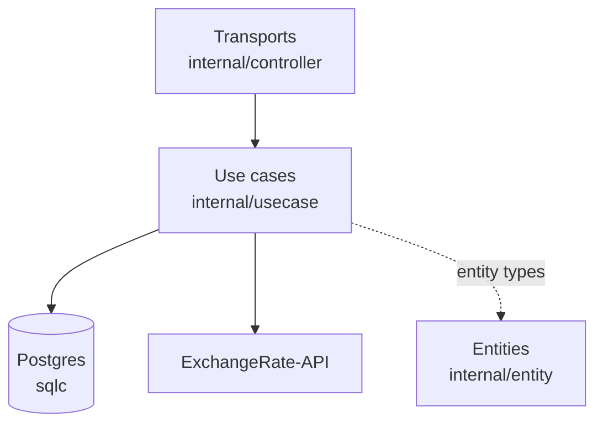

# Architecture

How the template is layered, the rules that keep it that way, and which package holds what. Every
change follows the [rules](#rules) below; a change that breaks one is not merged, however small.
[request-flow.md](request-flow.md) shows the rules at work on one real request.

## The dependency rule

Dependencies point inward. Controllers call use cases through the interfaces in
[`internal/usecase/contracts.go`](../internal/usecase/contracts.go); use cases call storage and outbound
APIs through the interfaces in [`internal/repo/contracts.go`](../internal/repo/contracts.go). Every layer
passes [`internal/entity`](../internal/entity) types, and `entity` imports nothing from this module.



<!-- scaffold:queue:begin -->
The queue worker (`cmd/worker`) is one more way in, beside the transports: its handlers in
`internal/controller/worker` call the same use cases, which enqueue through `repo.QueueRepo` into
the `queue_messages` table.
The `mail` use case it calls renders the mail templates and sends over SMTP. <!-- scaffold:email -->
<!-- scaffold:queue:end -->

Each transport is a controller package: [the packages table](#packages) lists them.
Controllers never import each other, and none of them knows about Postgres. A REST handler that needs
data goes through a use case, which goes through a repository interface. `pkg/` holds infrastructure
with no domain knowledge (servers, logger, JWT, Postgres pool, tracing and the like) and must not
import `internal/`.

## Rules

Clean Architecture only pays off while it stays clean. One shortcut, such as a handler that runs a query
"just this once", is copied by the next change, and in a few months the layers mean nothing. So these
are rules, not guidelines. When a rule gets in the way, the design is what has to change, not the rule.

### Dependencies

1. **Imports point inward only:** controller → use case → repo interfaces → entity. An inner layer
   never imports an outer one.
2. **`internal/entity` imports nothing from this module.** Domain types and their rules are plain Go.
3. **Use cases know only interfaces.** They depend on `internal/repo/contracts.go`, never on a
   repository implementation, and import no HTTP client, SQL driver or transport framework.
4. **Controllers call use cases, never repositories.** No SQL, no `pkg/postgres`, no outbound HTTP in a
   controller.
5. **Transports are independent.** The packages under `internal/controller/` never import each other.
   Logic two transports share belongs in a use case.
6. **`pkg/` never imports `internal/` or `config/`.** It takes its settings as arguments.
7. **Wiring happens once,** in `internal/app/app.go`. Nothing else constructs its own dependencies.

### Each layer's job

8. **A controller handler does six things, in order:** get the caller, decode into a transport-local
   DTO, validate structure, call the use case with the request's `ctx`, map `entity.Err*` sentinels to
   a transport status, and encode a response DTO. Nothing else. It never passes a request DTO into a use
   case, and returns an entity directly only when its JSON shape already is the API shape.
9. **A domain rule is written once, in the entity or the use case.** Never in a controller, and never
   duplicated per transport. A rule that only needs the value itself goes on the entity
   (`Task.Transition`, `entity.NewConversion`); a rule that needs a repository goes in the use case.
   Authorization is a domain rule too: "only an admin lists every user's tasks" is checked in
   `Task.ListAll`, not in middleware, so every transport enforces it the same way.
10. **Only controllers know transport errors.** Lower layers return sentinels from
    `internal/entity/errors.go` or errors wrapped with their layer path
    (`fmt.Errorf("TaskUseCase - Create - uc.repo.Store: %w", err)`).
11. **Every repository and use case is returned as its interface, wrapped in its tracing decorator**
    (`tracing.go`). A new contract method goes in the interface, the struct and the decorator.

### Where code goes

Ask what the code knows about:

| The code knows about… | It goes in |
| --- | --- |
| nothing but the domain | `internal/entity/<name>.go` |
| a business rule that needs storage or an outside API | `internal/usecase/<domain>/<domain>.go` |
| SQL | `internal/repo/persistent/queries/<domain>.sql`, then `make sqlc` |
| a table or a driver error code | `internal/repo/persistent/<domain>/<domain>.go` |
| an outbound HTTP API | `internal/repo/webapi/<name>.go` |
| a transport status or error code | `internal/controller/<transport>/v1/<domain>.go` |
| a queue message | `internal/controller/worker/v1/<name>.go` | <!-- scaffold:queue -->
| a server, client or middleware with no domain knowledge | `pkg/<name>/` |

If the code knows about two of these, it is two pieces of code in two layers.

### Reviewing a change

A reviewer checks the imports first:

- Does any `internal/entity` or `internal/usecase` file gain an import of a driver, a transport or a
  repository implementation?
- Does a controller import `internal/repo`, or another controller?
- Is there an `if` about the domain (status, ownership, currency) in a handler?
- Is a new contract method missing from its `tracing.go` decorator or from the mocks (`make mock`)?

Any "yes" is a rule broken, and the change goes back.

## Roles

The app knows two roles, `entity.RoleAdmin` and `entity.RoleUser`. A sign-in writes the caller's
roles into the app JWT (`roles` claim). A password sign-in always grants `user` (`entity.LocalRoles`).
A passkey sign-in does too. <!-- scaffold:passkeys -->
An SSO sign-in grants the roles the provider's claims map to ([sso.md](sso.md#roles)). <!-- scaffold:sso -->
Each transport's auth turns the token into an `entity.Principal`, dropping role names it does not
know:

- REST: `middleware.Principal`
- gRPC: `grpcmw.PrincipalFromContext` <!-- scaffold:grpc -->
- GraphQL: `graphql.Principal` <!-- scaffold:graphql -->

A handler passes the
principal to the use cases that check roles, such as
`Task.ListAll`, which returns `entity.ErrAdminRequired` to anyone without `admin`. Every other use
case still takes the plain user ID. Roles are fixed when the token is issued, so a change takes
effect at the next sign-in.

## Packages

| Package | What it holds |
| --- | --- |
| [`cmd/app`](../cmd/app/main.go) | Reads config, builds the logger, then hands over to `internal/app.Run`. |
| [`cmd/worker`](../cmd/worker/main.go) | Reads config, then `RunWorker` in `internal/app/worker.go`. Same Docker image as the app (`/worker` instead of `/app`); it never applies the schema. | <!-- scaffold:queue -->
| [`cmd/create`](../cmd/create/main.go) | `make scaffold`: the form (or flags) that picks features, then `internal/scaffold`. See [scaffold.md](scaffold.md). | <!-- scaffold:self -->
| [`internal/scaffold`](../internal/scaffold) | Generates a project with only some features: reads `scaffold/features.yaml`, copies the template without the dropped features' paths, strips their marked blocks, renames the module, runs the regen steps. Outside the layers: nothing imports it. | <!-- scaffold:self -->
| [`cmd/openapi`](../cmd/openapi/main.go) | Prints the REST OpenAPI document without a server or database. `make openapi` writes it to `docs/openapi/v1.json`. |
| [`internal/app`](../internal/app) | Wiring. `app.go` constructs every repository and use case once (`initUseCases`; each optional feature adds its own from its file here), starts the servers (`initServers`) and waits for a signal to shut down. See [Schema](#schema) for `migrate.go`. |
| [`internal/controller`](../internal/controller) | One package per transport, each with its own `v1/request` and `v1/response` DTOs. Handlers decode, call a use case, map `entity.Err*` sentinels to a transport status, and encode. |
| [`internal/controller/restapi`](../internal/controller/restapi) | REST: [chi](https://github.com/go-chi/chi) routes wrapped by [Huma](https://github.com/danielgtaylor/huma), which builds the OpenAPI document. |
| [`internal/controller/grpc`](../internal/controller/grpc) | gRPC, from the `.proto` files in `docs/proto`. | <!-- scaffold:grpc -->
| [`internal/controller/graphql`](../internal/controller/graphql) | GraphQL: [gqlgen](https://github.com/99designs/gqlgen) resolvers mounted on the REST router. | <!-- scaffold:graphql -->
| [`internal/controller/worker`](../internal/controller/worker) | The queue worker's message handlers. | <!-- scaffold:queue -->
| [`internal/entity`](../internal/entity) | Domain types, their invariants (`Task.Transition`, `entity.NewConversion`) and sentinel errors. |
| [`internal/usecase`](../internal/usecase) | Business logic, one package per domain. Every constructor returns its interface wrapped in a tracing decorator (`tracing.go`). |
| [`internal/usecase/passkey`](../internal/usecase/passkey) | WebAuthn registration and sign-in. The only package that imports [go-webauthn](https://github.com/go-webauthn/webauthn); controllers pass it the browser's JSON as bytes. Ceremony state travels in a signed token and a login challenge is burned on finish. See [passkeys.md](passkeys.md). | <!-- scaffold:passkeys -->
| [`internal/usecase/oidc`](../internal/usecase/oidc) | SSO sign-in through an OpenID Connect provider. The only package that imports [go-oidc](https://github.com/coreos/go-oidc) and `x/oauth2`; it maps the provider's role claim to app roles. See [sso.md](sso.md). | <!-- scaffold:sso -->
| [`internal/repo/persistent`](../internal/repo/persistent) | Postgres repositories. SQL lives in `queries/*.sql` and [sqlc](https://sqlc.dev/) compiles it to typed Go; there is no ORM. `make sqlc` first renders the HCL schema to `queries/schema/schema.sql` with Atlas in a throwaway container, so it needs Docker. |
| [`internal/repo/persistent/passkey`](../internal/repo/persistent/passkey) | Passkeys (`webauthn_credentials`, the library's credential record in a `jsonb` column) and burned login challenges (`webauthn_used_challenges`). A unique violation is `entity.ErrPasskeyExists`; a burn that inserts no row is `entity.ErrPasskeyChallengeUsed`. | <!-- scaffold:passkeys -->
| [`internal/repo/persistent/identity`](../internal/repo/persistent/identity) | Provider identities (`user_identities`, keyed by issuer and subject) and the password-less users they create, in one statement. A taken email or username is `entity.ErrAccountConflict`. | <!-- scaffold:sso -->
| [`internal/repo/webapi`](../internal/repo/webapi) | Outbound HTTP. `exchange_openerapi.go` reads daily rates from open.er-api.com with plain `net/http`, decodes them straight into `decimal.Decimal`, and maps the provider's `unsupported-code` error (sent with HTTP 200) to `entity.ErrUnsupportedCurrency`. Its unit test serves the recorded response in `testdata/`. |
| [`internal/repo/mailtmpl`](../internal/repo/mailtmpl) | Email rendering. See [worker.md](worker.md). | <!-- scaffold:email -->
| [`internal/repo/notify`](../internal/repo/notify) | `repo.UserNotifier`: turns account events (the welcome) into emails on the mail queue, so the user use case knows nothing about queues or email encoding. | <!-- scaffold:welcome -->
| [`pkg/jwt`](../pkg/jwt) | `Manager` signs and parses the auth JWT. `Scoped` signs short-lived payloads for one purpose, with a key derived from the same secret by HKDF and the purpose as audience, so neither token passes for the other; a sign-in flow that spans two requests keeps its state in one. The auth JWT carries a `roles` claim ([Roles](#roles)). |
| [`pkg/tracing`](../pkg/tracing) | OpenTelemetry setup; a no-op provider when tracing is off. See [configuration.md](configuration.md#tracing). |
| [`pkg/worker`](../pkg/worker) | The queue consumer. See [worker.md](worker.md). | <!-- scaffold:queue -->
| [`pkg/smtp`](../pkg/smtp) | The SMTP client. See [worker.md](worker.md#smtp). | <!-- scaffold:email -->

### Schema

The schema is declarative: `internal/app/schema/*.hcl`, one file per table, embedded in the binary.
Built with the `migrate` tag (`make run`, `make dev` and the Dockerfile do this), the app diffs that
schema against its database at startup with [Atlas](https://atlasgo.io/) and makes the database match.
There are no migration files and no separate dev database. The apply creates what is missing **and
drops tables and columns the HCL does not declare**, so check `PG_URL` before starting the app.

```sh
go run -tags migrate ./cmd/app
```

## Dependency injection

To keep business logic independent of external packages, dependencies are injected through the `New`
constructor:

```go
package usecase

import (
// Nothing!
)

type Repository interface {
	Get()
}

type UseCase struct {
	repo Repository
}

func New(r Repository) *UseCase {
	return &UseCase{
		repo: r,
	}
}

func (uc *UseCase) Do() {
	uc.repo.Get()
}
```

Any implementation of the interface can replace another without a change to the `usecase` package. It
also makes the interfaces mockable: this repo generates gomock mocks from the two `contracts.go` files
(`make mock`).

For a large number of injections, [wire](https://github.com/google/wire) can generate the wiring.

## Clean Architecture

### Key idea

Programmers realize the optimal architecture for an application after most of the code has been written.

> A good architecture allows decisions to be delayed to as late as possible.

### The main principle

Dependency Inversion (the same one from SOLID) is the principle of dependency injection.
The direction of dependencies goes from the outer layer to the inner layer.
Due to this, business logic and entities remain independent from other parts of the system.

So, the application is divided into 2 layers, internal and external:

1. **Business logic** (Go standard library).
2. **Tools** (databases, servers, message brokers, any other packages and frameworks).


**The inner layer** with business logic should be clean. It should:

- Not have package imports from the outer layer.
- Use only the capabilities of the standard library.
- Make calls to the outer layer through the interface (!).

The business logic doesn't know anything about Postgres or a specific web API.
Business logic has an interface for working with an _abstract_ database or _abstract_ web API.

**The outer layer** has other limitations:

- All components of this layer are unaware of each other's existence. How to call another from one tool? Not directly,
  only through the inner layer of business logic.
- All calls to the inner layer are made through the interface (!).
- Data is transferred in a format that is convenient for business logic (`internal/entity`).

For example, you need to access the database from HTTP (controller).
Both HTTP and database are in the outer layer, which means they know nothing about each other.
The communication between them is carried out through `usecase` (business logic):

```
    HTTP > usecase
           usecase > repository (Postgres)
           usecase < repository (Postgres)
    HTTP < usecase
```

The symbols > and < show the intersection of layer boundaries through Interfaces.
The same is shown in the picture:


Or more complex business logic:

```
    HTTP > usecase
           usecase > repository
           usecase < repository
           usecase > webapi
           usecase < webapi
           usecase > RPC
           usecase < RPC
           usecase > repository
           usecase < repository
    HTTP < usecase
```

### Layers


### Clean Architecture terminology

- **Entities** are structures that business logic operates on.
  They are located in the `internal/entity` folder.
  In MVC terms, entities are models.
- **Use Cases** is business logic located in `internal/usecase`.

The layer with which business logic directly interacts is usually called the _infrastructure_ layer.
These can be repositories `internal/repo/persistent`, external webapi `internal/repo/webapi`, any pkg, and other
microservices.
In the template, the _infrastructure_ packages are located inside `internal/repo`.

You can choose how to call the entry points as you wish. The options are:

- controller (in our case)
- delivery
- transport
- gateways
- entrypoints
- primary
- input

### Additional layers

The classic version
of [Clean Architecture](https://blog.cleancoder.com/uncle-bob/2012/08/13/the-clean-architecture.html) was designed for
building large monolithic applications and has 4 layers.

In the original version, the outer layer is divided into two more, which also have an inversion of dependencies
to each other (directed inward) and communicate through interfaces.

The inner layer is also divided into two (with separation of interfaces), in the case of complex logic.

Complex tools can be divided into additional layers.
However, you should add layers only if really necessary.

### Alternative approaches

In addition to Clean architecture, _Onion architecture_ and _Hexagonal_ (_Ports and adapters_) are similar to it.
Both are based on the principle of Dependency Inversion.
_Ports and adapters_ are very close to _Clean Architecture_, the differences are mainly in terminology.

## Similar projects

- [evrone/go-clean-template](https://github.com/evrone/go-clean-template), which this repository is forked from
- [bxcodec/go-clean-arch](https://github.com/bxcodec/go-clean-arch)
- [zhashkevych/courses-backend](https://github.com/zhashkevych/courses-backend)

## Useful links

- [The Clean Architecture article](https://blog.cleancoder.com/uncle-bob/2012/08/13/the-clean-architecture.html)
- [The Twelve-Factor App](https://12factor.net/)
