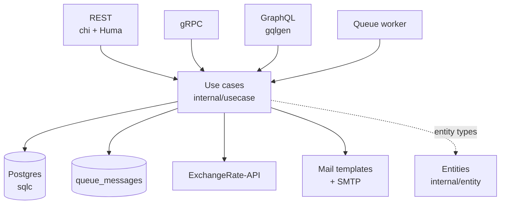

# Architecture

How the template is layered, why, and which package holds what. For the rules an agent or contributor
follows when adding code, see [CLAUDE.md](../CLAUDE.md).

## The dependency rule

Dependencies point inward. Controllers call use cases through the interfaces in
[`internal/usecase/contracts.go`](../internal/usecase/contracts.go); use cases call storage and outbound
APIs through the interfaces in [`internal/repo/contracts.go`](../internal/repo/contracts.go). Every layer
passes [`internal/entity`](../internal/entity) types, and `entity` imports nothing from this module.



Controllers never import each other, and none of them knows about Postgres. A REST handler that needs
data goes through a use case, which goes through a repository interface. `pkg/` holds infrastructure
with no domain knowledge (servers, logger, JWT, Postgres pool, tracing, worker, SMTP) and must not
import `internal/`.

## Packages

| Package | What it holds |
| --- | --- |
| [`cmd/app`](../cmd/app/main.go) | Reads config, builds the logger, then hands over to `internal/app.Run`. |
| [`cmd/worker`](../cmd/worker/main.go) | Reads config, then `RunWorker` in `internal/app/worker.go`. Same Docker image as the app (`/worker` instead of `/app`); it never applies the schema. |
| [`cmd/openapi`](../cmd/openapi/main.go) | Prints the REST OpenAPI document without a server or database. `make openapi` writes it to `docs/openapi/v1.json`. |
| [`internal/app`](../internal/app) | Wiring. `app.go` constructs every repository and use case once (`initUseCases`), starts the servers (`initServers`) and waits for a signal to shut down. See [Schema](#schema) for `migrate.go`. |
| [`internal/controller`](../internal/controller) | One package per transport (`restapi`, `grpc`, `graphql`, `worker`), each with its own `v1/request` and `v1/response` DTOs. Handlers decode, call a use case, map `entity.Err*` sentinels to a transport status, and encode. |
| [`internal/entity`](../internal/entity) | Domain types, their invariants (`Task.Transition`, `entity.NewConversion`) and sentinel errors. |
| [`internal/usecase`](../internal/usecase) | Business logic, one package per domain. Every constructor returns its interface wrapped in a tracing decorator (`tracing.go`). |
| [`internal/repo/persistent`](../internal/repo/persistent) | Postgres repositories. SQL lives in `queries/*.sql` and [sqlc](https://sqlc.dev/) compiles it to typed Go; there is no ORM. `make sqlc` first renders the HCL schema to `queries/schema/schema.sql` with Atlas in a throwaway container, so it needs Docker. |
| [`internal/repo/webapi`](../internal/repo/webapi) | Outbound HTTP. `exchange_openerapi.go` reads daily rates from open.er-api.com with plain `net/http`, decodes them straight into `decimal.Decimal`, and maps the provider's `unsupported-code` error (sent with HTTP 200) to `entity.ErrUnsupportedCurrency`. Its unit test serves the recorded response in `testdata/`. |
| [`internal/repo/mailtmpl`](../internal/repo/mailtmpl) | Email rendering. See [worker.md](worker.md). |
| [`pkg/tracing`](../pkg/tracing) | OpenTelemetry setup; a no-op provider when tracing is off. See [configuration.md](configuration.md#tracing). |
| [`pkg/worker`](../pkg/worker), [`pkg/smtp`](../pkg/smtp) | The queue consumer and the SMTP client. See [worker.md](worker.md). |

### Schema

The schema is declarative: `internal/app/schema/*.hcl`, one file per table, embedded in the binary.
Built with the `migrate` tag (`make run`, `make dev` and the Dockerfile do this), the app diffs that
schema against its database at startup with [Atlas](https://atlasgo.io/) and makes the database match.
There are no migration files and no separate dev database. The apply creates what is missing **and
drops tables and columns the HCL does not declare**, so check `PG_URL` before starting the app.

```sh
go run -tags migrate ./cmd/app
```

## Dependency injection

To keep business logic independent of external packages, dependencies are injected through the `New`
constructor:

```go
package usecase

import (
// Nothing!
)

type Repository interface {
	Get()
}

type UseCase struct {
	repo Repository
}

func New(r Repository) *UseCase {
	return &UseCase{
		repo: r,
	}
}

func (uc *UseCase) Do() {
	uc.repo.Get()
}
```

Any implementation of the interface can replace another without a change to the `usecase` package. It
also makes the interfaces mockable: this repo generates gomock mocks from the two `contracts.go` files
(`make mock`).

For a large number of injections, [wire](https://github.com/google/wire) can generate the wiring.

## Clean Architecture

### Key idea

Programmers realize the optimal architecture for an application after most of the code has been written.

> A good architecture allows decisions to be delayed to as late as possible.

### The main principle

Dependency Inversion (the same one from SOLID) is the principle of dependency injection.
The direction of dependencies goes from the outer layer to the inner layer.
Due to this, business logic and entities remain independent from other parts of the system.

So, the application is divided into 2 layers, internal and external:

1. **Business logic** (Go standard library).
2. **Tools** (databases, servers, message brokers, any other packages and frameworks).

**The inner layer** with business logic should be clean. It should:

- Not have package imports from the outer layer.
- Use only the capabilities of the standard library.
- Make calls to the outer layer through the interface (!).

The business logic doesn't know anything about Postgres or a specific web API.
Business logic has an interface for working with an _abstract_ database or _abstract_ web API.

**The outer layer** has other limitations:

- All components of this layer are unaware of each other's existence. How to call another from one tool? Not directly,
  only through the inner layer of business logic.
- All calls to the inner layer are made through the interface (!).
- Data is transferred in a format that is convenient for business logic (`internal/entity`).

For example, you need to access the database from HTTP (controller).
Both HTTP and database are in the outer layer, which means they know nothing about each other.
The communication between them is carried out through `usecase` (business logic):

```
    HTTP > usecase
           usecase > repository (Postgres)
           usecase < repository (Postgres)
    HTTP < usecase
```

The symbols > and < show the intersection of layer boundaries through Interfaces.

Or more complex business logic:

```
    HTTP > usecase
           usecase > repository
           usecase < repository
           usecase > webapi
           usecase < webapi
           usecase > RPC
           usecase < RPC
           usecase > repository
           usecase < repository
    HTTP < usecase
```

### Clean Architecture terminology

- **Entities** are structures that business logic operates on.
  They are located in the `internal/entity` folder.
  In MVC terms, entities are models.
- **Use Cases** is business logic located in `internal/usecase`.

The layer with which business logic directly interacts is usually called the _infrastructure_ layer.
These can be repositories `internal/repo/persistent`, external webapi `internal/repo/webapi`, any pkg, and other
microservices.
In the template, the _infrastructure_ packages are located inside `internal/repo`.

You can choose how to call the entry points as you wish. The options are:

- controller (in our case)
- delivery
- transport
- gateways
- entrypoints
- primary
- input

### Additional layers

The classic version
of [Clean Architecture](https://blog.cleancoder.com/uncle-bob/2012/08/13/the-clean-architecture.html) was designed for
building large monolithic applications and has 4 layers.

In the original version, the outer layer is divided into two more, which also have an inversion of dependencies
to each other (directed inward) and communicate through interfaces.

The inner layer is also divided into two (with separation of interfaces), in the case of complex logic.

Complex tools can be divided into additional layers.
However, you should add layers only if really necessary.

### Alternative approaches

In addition to Clean architecture, _Onion architecture_ and _Hexagonal_ (_Ports and adapters_) are similar to it.
Both are based on the principle of Dependency Inversion.
_Ports and adapters_ are very close to _Clean Architecture_, the differences are mainly in terminology.

## Similar projects

- [evrone/go-clean-template](https://github.com/evrone/go-clean-template), which this repository is forked from
- [bxcodec/go-clean-arch](https://github.com/bxcodec/go-clean-arch)
- [zhashkevych/courses-backend](https://github.com/zhashkevych/courses-backend)

## Useful links

- [The Clean Architecture article](https://blog.cleancoder.com/uncle-bob/2012/08/13/the-clean-architecture.html)
- [The Twelve-Factor App](https://12factor.net/)
