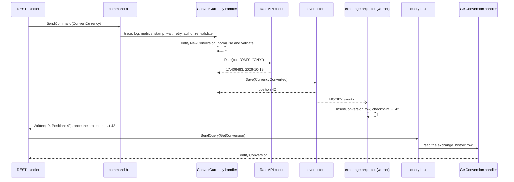

# A request, end to end

This page follows one request through every layer of the template, file by file:

```http
POST /v1/exchange/convert
Authorization: Bearer <token>
Content-Type: application/json

{"from": "omr", "to": "CNY", "amount": "100"}
```

```json
{"from": "OMR", "to": "CNY", "amount": "100", "rate": "17.406483", "result": "1740.65", "rate_date": "2026-10-19"}
```

The exchange domain is used because it is the only one that touches every kind of dependency:
- an inbound transport;
- a domain rule;
- an outbound HTTP API;
- the event store;
- a projection.

The other domains follow the same shape with fewer steps. [architecture.md](architecture.md)
explains why the layers exist, and [cqrs.md](cqrs.md) explains the command and query split; this
page shows what each part does.



## 0. Wiring

Nothing below constructs its own dependencies. [`internal/app/buses.go`](../internal/app/buses.go)
builds the two buses once, and each domain's module registers its handlers on them; for exchange,
[`internal/app/exchange.go`](../internal/app/exchange.go):

```go
exchange.Register(b.Commands, b.Queries, exchange.Deps{
	Store: d.store, Rates: webapi.New(d.cfg.Exchange.ServiceURL), History: persistExchangeRepo.NewReadModel(d.pg),
})
```

[`internal/usecase/exchange/register.go`](../internal/usecase/exchange/register.go) lists its
handlers, one line each. The transports get the buses and nothing else:

```go
rest: restexchange.NewRoutes, // exchange.go: NewRoutes(api, b, l)
r.Handle("/graphql", graphql.NewHandler(b, tokens, l)) // http.go
pb.RegisterExchangeServiceServer(s, grpcexchange.New(b, l)) // exchange.go
```

Every handler's dependency is an **interface** from
[`internal/repo/contracts.go`](../internal/repo/contracts.go): `repo.EventStore`,
`repo.ExchangeWebAPI` and `repo.ExchangeReadModel`. A handler never learns which implementation it
got, which is what lets the unit tests hand it the in-memory store and mocks instead.

## 1. Middleware

The app's HTTP mux, [`internal/app/http.go`](../internal/app/http.go), installs chi middleware in
this order, and mounts the REST API ([`restapi.NewHandler`](../internal/controller/restapi/router.go)),
which adds `Auth`, before any handler runs:

| Middleware | What it does to this request |
| --- | --- |
| `StripSlashes` | `/v1/exchange/convert/` and `/v1/exchange/convert` are the same route |
| `Logger` | logs client address, method, path, status and response size when the request ends |
| `Tracing` (when `TRACING_ENABLED`) | starts the server span and reads an incoming `traceparent`, so a caller's trace continues here |
| `Metrics` (when `METRICS_ENABLED`) | counts the request in `http_requests_total` and times it in `http_request_duration_seconds`, labeled with the route pattern |
| `Recovery` | turns a panic in any later layer into a 500 instead of a dropped connection |
| `Auth` | every path under `/v1` except `/v1/auth/*` needs `Authorization: Bearer <token>`. It parses the JWT and stores the user ID in the request context, or answers 401 |

`Auth` is the only thing that knows about JWTs. Below this point the caller is just a `userID` string.

## 2. Decode and validate (Huma)

The handler is registered with [Huma](https://github.com/danielgtaylor/huma) in
[`internal/controller/restapi/v1/exchange/exchange.go`](../internal/controller/restapi/v1/exchange/exchange.go),
in the exchange domain's folder. Its input type wraps a transport-local DTO from the same folder's
[`request.go`](../internal/controller/restapi/v1/exchange/request.go):

```go
type Convert struct {
	From   string `json:"from" pattern:"^[A-Za-z]{3}$" example:"EUR"`
	To     string `json:"to" pattern:"^[A-Za-z]{3}$" example:"USD"`
	Amount string `json:"amount" pattern:"^[0-9]{1,15}(\\.[0-9]{1,8})?$" example:"100.10"`
}
```

Huma decodes the body into it and checks the tags **before the handler is called**. A body that
fails them never reaches Go code you wrote: Huma answers `422` with an RFC 9457 problem naming the
failing field. The same tags also produce:

- the OpenAPI schema at `/openapi.json`
- the checked-in [`openapi/v1.json`](openapi/v1.json)
- the TypeScript types in `web/`

One declaration, and nothing to keep in sync by hand.

The DTO checks only **shape**: three letters, a decimal-looking string. Whether `"omr"` and `"OMR"` are
the same currency, or whether converting OMR to OMR makes sense, is a domain rule and lives in the
entity (step 5).

`Amount` is a string on purpose. A JSON number would be decoded into a `float64` somewhere, and money
must never pass through a float.

## 3. The handler

The handler body does the same steps in the same order as every handler on every transport:

```go
userID, ok := middleware.UserID(ctx)          // 1. who is calling
if !ok {
	return nil, huma.Error401Unauthorized("unauthorized")
}

amount, err := decimal.NewFromString(input.Body.Amount)  // 2. DTO → domain value
if err != nil {
	return nil, huma.Error422UnprocessableEntity("invalid amount")
}

written, err := cqrs.SendCommand(ctx, r.cmds, command.ConvertCurrency{  // 3. the write
	UserID: userID, From: input.Body.From, To: input.Body.To, Amount: amount,
})
if err != nil {
	return nil, apierr.Problem(ctx, r.l, err, "convert")  // 4. error kind → status
}

conversion, err := cqrs.SendQuery(ctx, r.qs,  // 5. read it back
	query.GetConversion{UserID: userID, ConversionID: written.ID})
if err != nil {
	return nil, apierr.Problem(ctx, r.l, err, "convert")
}

return &convertOutput{Body: NewConversion(&conversion)}, nil  // 6. entity → response DTO
```

- **A command returns only what identifies the write.** `entity.Written` holds the conversion's ID and
  the event store position of its event, never the conversion itself. The body comes from a query,
  so every response a client sees was read from the read model, just as its next request will be.
- **`ctx` is passed down unchanged.** It is Huma's request context: it carries the trace span, and
  it is cancelled if the client disconnects, which cancels the outbound HTTP call and the event
  store's transaction below.
- **[`apierr.Problem`](../internal/controller/restapi/v1/apierr/apierr.go) maps errors, for every
  domain.** Each `entity.Err*` carries its kind: `ErrInvalidConversion` and `ErrUnsupportedCurrency`
  are invalid (400), `ErrReadModelBehind` is unavailable (503), `ErrConcurrencyConflict` a conflict
  (409), and a [generated](generator.md) stub's `ErrNotImplemented` 501. Anything that is not an
  `*entity.Error` is logged and becomes a 500.
- **The DTO and the entity never cross the boundary.** The handler never passes the `Convert` DTO to
  a command, and never returns `entity.Conversion` as the body. `NewConversion` (the folder's
  [`response.go`](../internal/controller/restapi/v1/exchange/response.go)) turns every
  `decimal.Decimal` into a string and the date into `YYYY-MM-DD`.

## 4. The command bus

`SendCommand` finds the one handler registered for `ConvertCurrency` and runs the message through
the pipeline from [`newBuses`](../internal/app/buses.go), outermost first:

| Step | Package | What it does to this command |
| --- | --- | --- |
| trace | `pkg/cqrs` | opens the `command ConvertCurrency` span |
| log | `pkg/cqrs` | logs the outcome and duration at debug |
| metrics | `pkg/cqrs` | counts it in `cqrs_messages_total` and times it in `cqrs_message_duration_seconds` |
| stamp | `internal/usecase/behavior` | puts the caller's user ID and `command ConvertCurrency` in the context's event metadata |
| wait | `internal/usecase/behavior` | after the handler: holds the result until every projector has passed `Written.Position` (step 8) |
| retry | `internal/usecase/behavior` | runs the handler again on `entity.ErrConcurrencyConflict`, three attempts in all |
| authorize | `internal/usecase/behavior` | nothing here: `ConvertCurrency` needs no role |
| validate | `internal/usecase/behavior` | nothing here: `ConvertCurrency` has no `Validate` |

Tracing, logging and metrics are steps, so no handler carries them, and none can forget them.

## 5. The command handler

[`internal/usecase/exchange/command/convert_currency.go`](../internal/usecase/exchange/command/convert_currency.go)
holds the command and its handler, and nothing else:

```go
func (h ConvertCurrencyHandler) Handle(ctx context.Context, cmd ConvertCurrency) (entity.Written, error) {
	conversion, err := entity.NewConversion(cmd.From, cmd.To, cmd.Amount)
	if err != nil {
		return entity.Written{}, fmt.Errorf("ConvertCurrency - entity.NewConversion: %w", err)
	}

	rate, date, err := h.Rates.Rate(ctx, conversion.From, conversion.To)
	if err != nil {
		return entity.Written{}, fmt.Errorf("ConvertCurrency - h.Rates.Rate: %w", err)
	}

	conversion.ApplyRate(rate, date)

	id := uuid.NewString()

	written, err := aggregate.Save(ctx, h.Store,
		entity.NewConversionAggregate(id, cmd.UserID, &conversion, aggregate.Now(h.Now)))
	if err != nil {
		return entity.Written{}, fmt.Errorf("ConvertCurrency - aggregate.Save: %w", err)
	}

	return written, nil
}
```

- Validation runs first, so a bad request never costs a call to the provider.
- The rules are the entity's ([`exchange.go`](../internal/entity/exchange.go)):
  - `NewConversion` uppercases `"omr"` to `"OMR"`, once, for every transport. gRPC requests carry no
    Huma tags, so this is the check that protects them. It refuses a code that isn't three letters,
    `from` equal to `to`, and an amount that isn't positive or has more than 15 digits before the
    point or 8 after it.
  - `ApplyRate` rounds half-to-even, the usual rule for money: `100 × 17.406483 = 1740.6483` →
    `1740.65`.
- `NewConversionAggregate` ([`exchange_aggregate.go`](../internal/entity/exchange_aggregate.go))
  records the conversion as one event, `CurrencyConverted`. A conversion never changes, so its stream
  `conversion-<id>` holds that one event. Its amounts are `decimal.Decimal`, which encode to JSON as
  strings, so no amount passes through a float on its way to the store.
- `aggregate.Save` saves the new aggregate and returns `Written`. `aggregate.Now` is the time to the
  microsecond in UTC, the precision of the read model's timestamp columns.

## 6. The outbound API

[`internal/repo/webapi/exchange_openerapi.go`](../internal/repo/webapi/exchange_openerapi.go)
implements `repo.ExchangeWebAPI` against the
[ExchangeRate-API open access endpoint](https://www.exchangerate-api.com/docs/free):
`GET {EXCHANGE_SERVICE_URL}/v6/latest/OMR`.

- **Errors arrive as HTTP 200.** The provider answers `{"result": "error", "error-type":
  "unsupported-code"}` with status 200, so the client checks `result`, not only the status code.
  `unsupported-code`, or a target currency missing from `rates`, becomes
  `entity.ErrUnsupportedCurrency`, which the handler turns into a 400. Any other failure stays a
  wrapped error and becomes a 500.
- **Rates never touch a float.** The response struct declares `Rates map[string]decimal.Decimal`, so
  `encoding/json` hands each number's text straight to `decimal`.
- **The date is the provider's.** `time_last_update_unix` is truncated to a UTC date and returned with
  the rate, so the response says which day's rate it used, not when the request ran.
- **It joins the trace.** The `http.Client` uses an `otelhttp` transport, so the outbound GET is a
  child span of the `command ConvertCurrency` span and sends `traceparent` onward. It has a 5-second timeout and
  uses the request's `ctx`, so a client disconnect cancels it.

This is the only file that knows the provider's URL layout or JSON shape. Switching providers means a
new implementation of the same interface. The command handler doesn't change.

## 7. The event store

[`internal/repo/persistent/eventstore/eventstore.go`](../internal/repo/persistent/eventstore/eventstore.go)
implements `repo.EventStore.Save`. It runs one transaction, joining the context's if there is one:

1. `pg_advisory_xact_lock` on the store's key. Appends run one at a time, so positions commit in
   the order they are assigned.
2. Check the stream's stored version against the version the aggregate was loaded at: 0, a new
   stream. A mismatch is `entity.ErrConcurrencyConflict`, which the retry step acts on.
3. Insert the event into `events` with its type, schema version, JSON payload and metadata (the
   user, the trace ID, `command ConvertCurrency`), through the sqlc query `AppendEvent`.
4. `NOTIFY events`, which Postgres delivers to the worker when the transaction commits.

The events table, like every table, is declared in [`internal/app/schema/`](../internal/app/schema/)
(`events.hcl`), and its queries are SQL in
[`queries/eventstore.sql`](../internal/repo/persistent/queries/eventstore.sql) that `make sqlc`
turns into typed Go.

## 8. The projector, and the wait

The worker runs one loop per projector
([`internal/repo/persistent/projection/runner.go`](../internal/repo/persistent/projection/runner.go)).
The `NOTIFY` wakes the exchange projector's loop, which:
1. reads the events after its checkpoint;
2. hands `CurrencyConverted` to
   [`persistent/exchange/projector.go`](../internal/repo/persistent/exchange/projector.go):

   ```go
   case entity.CurrencyConverted:
   	err = q.InsertConversionRow(ctx, queries.InsertConversionRowParams{
   		ConversionID: &ev.ConversionID, UserID: ev.UserID, FromCurrency: ev.From, ToCurrency: ev.To,
   		Amount: ev.Amount, Rate: ev.Rate, Result: ev.Result, RateDate: ev.RateDate, CreatedAt: ev.At,
   	})
   ```

3. moves its checkpoint to the event's position, in the same transaction as the insert. The row and
   the checkpoint commit together or not at all, so a crash between them can neither lose the row nor
   insert it twice.

Meanwhile the app's wait step is polling `projection_checkpoints`. Once every projector is at or past
the command's position, `SendCommand` returns. If they are still behind after
`CQRS_CONSISTENCY_TIMEOUT` (2s), it returns `entity.ErrReadModelBehind` and the client gets a 503:
the conversion is saved, but a read could still miss it.

## 9. The query

`SendQuery(GetConversion)` runs through the query bus's steps (trace, log, metrics, stamp,
authorize, validate) to
[`query/get_conversion.go`](../internal/usecase/exchange/query/get_conversion.go), which reads
the row from `repo.ExchangeReadModel` and only from it. A query never touches the event store.

## The trace

With `TRACING_ENABLED=true`, this request shows up in Jaeger as one trace:

```
POST /v1/exchange/convert                      (otelhttp server span, REST middleware)
├── command ConvertCurrency                    (the command bus)
│   ├── HTTP GET                               (otelhttp client span → open.er-api.com)
│   └── EventStore.Save                        stream.id, events.count
└── query GetConversion                        (the query bus)
    └── ExchangeReadModel.Conversion
```

The projector's insert runs in the worker, so it isn't part of this trace; the event's metadata
carries the trace ID as its correlation ID.

## Where each failure ends up

| What went wrong | Caught by | REST |
| --- | --- | --- |
| No token, malformed header, expired token | `Auth` middleware | 401 |
| `from` not three letters, amount not a decimal string | Huma tags on `request.Convert` | 422 |
| Amount that doesn't parse as a decimal | handler | 422 |
| `from` = `to`, amount ≤ 0, bad code shape | `entity.NewConversion` → `ErrInvalidConversion` | 400 |
| Currency the provider doesn't know | webapi → `ErrUnsupportedCurrency` | 400 |
| Saved, but the projector didn't catch up in time | wait step → `ErrReadModelBehind` | 503 |
| Provider down, non-200, bad JSON; database error | wrapped error, logged by the handler | 500 |

The caller sees a fixed message (`"unsupported currency"`, `"internal server error"`). The wrapped
error with the layer path goes only to the log.

## The same command over gRPC

[`internal/controller/grpc/v1/exchange/exchange.go`](../internal/controller/grpc/v1/exchange/exchange.go) is the same
six steps with different types:

| | REST | gRPC |
| --- | --- | --- |
| who is calling | the `Auth` middleware | `grpcmw.UserIDFromContext` |
| the request | a Huma DTO | the generated `v1.ConvertRequest` |
| errors | 400 | `codes.InvalidArgument` |
| the response | `NewConversion` | `NewConversionResponse` |
| error kind → status | `apierr.Problem` | `rpcerr.Status` |

It sends the identical `ConvertCurrency` and `GetConversion`, so the two transports cannot disagree
about a rule.

On gRPC:
- the gRPC interceptor rejects a missing or expired token with `Unauthenticated`;
- there are no Huma tags, so a malformed code falls through to the entity;
- a bad amount, an invalid conversion and an unknown currency are all `InvalidArgument`;
- a lagging read model is `Unavailable`;
- the 500 cases are `Internal`.

GraphQL exposes only the history query (`exchangeHistory`): conversion is a form, and forms use REST.

## How each layer is tested

Each layer is tested at its own boundary, with the layer below replaced:

| Layer | Test | What stands in for the layer below |
| --- | --- | --- |
| Entity | [`entity/exchange_test.go`](../internal/entity/exchange_test.go), [`exchange_aggregate_test.go`](../internal/entity/exchange_aggregate_test.go) | nothing; plain values |
| Command handler | [`command/convert_currency_test.go`](../internal/usecase/exchange/command/convert_currency_test.go) | the in-memory event store (`internal/repo/memstore`), and a gomock rate client from `repomock` |
| Query handlers | [`query/query_test.go`](../internal/usecase/exchange/query/query_test.go) | a gomock read model from `repomock` |
| Projector | [`persistent/exchange/projector_test.go`](../internal/repo/persistent/exchange/projector_test.go) | a fake of sqlc's `Querier` |
| Rate client | [`webapi/exchange_openerapi_test.go`](../internal/repo/webapi/exchange_openerapi_test.go) | an `httptest` server replaying a recorded OMR response from `testdata/` |
| Whole stack | [`integration-test/exchange_test.go`](../integration-test/exchange_test.go) | a Caddy stub serving that same recorded response, so the suite never calls the real provider |

The memstore passes the same contract suite as the Postgres store
([`internal/repo/eventstoretest`](../internal/repo/eventstoretest/suite.go)), so a handler tested on
it behaves the same in production.

## Adding your own

A new operation follows the same path: a command or query and its handler in their own file, a line
in the domain's `register.go`, a test beside it, then a handler per transport. The checklist is in
[CLAUDE.md](../CLAUDE.md#adding-a-use-case-to-an-existing-domain).
