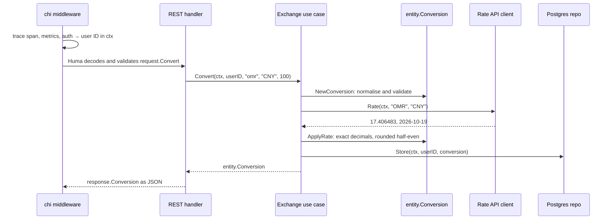

# A request, end to end

This page follows one request through every layer of the template, file by file:

```http
POST /v1/exchange/convert
Authorization: Bearer <token>
Content-Type: application/json

{"from": "omr", "to": "CNY", "amount": "100"}
```

```json
{"from": "OMR", "to": "CNY", "amount": "100", "rate": "17.406483", "result": "1740.65", "rate_date": "2026-10-19"}
```

The exchange domain is used because it is the only one that touches every kind of dependency:
an inbound transport, a domain rule, an outbound HTTP API, and Postgres. The other domains follow the
same shape with fewer steps. [architecture.md](architecture.md) explains why the layers exist; this
page shows what each one does.



## 0. Wiring

Nothing below constructs its own dependencies. [`internal/app/app.go`](../internal/app/app.go) builds
everything once, inner to outer:

```go
exchange: exchange.New(persistExchangeRepo.New(pg), webapi.New(cfg.Exchange.ServiceURL)),
```

and passes the use case to every transport that exposes it, each wired in its own file:

```go
router := restapi.NewRouter(cfg, uc.exchange, uc.user, uc.task, jwtManager, l) // app.go
```
<!-- scaffold:graphql:begin -->

```go
router.Handle("/graphql", graphql.NewHandler(uc.task, uc.exchange, jwtManager, l)) // graphql.go
```
<!-- scaffold:graphql:end -->
<!-- scaffold:grpc:begin -->

```go
grpc.NewRouter(grpcServer.App, uc.exchange, uc.user, uc.task, l) // grpc.go
```
<!-- scaffold:grpc:end -->

Every `New` returns an **interface** (`repo.ExchangeRepo`, `repo.ExchangeWebAPI`, `usecase.Exchange`),
already wrapped in a tracing decorator. The use case never learns which implementation it got, which is
what lets the unit tests hand it mocks instead.

## 1. Middleware

[`internal/controller/restapi/router.go`](../internal/controller/restapi/router.go) installs chi
middleware in this order, before any handler runs:

| Middleware | What it does to this request |
| --- | --- |
| `StripSlashes` | `/v1/exchange/convert/` and `/v1/exchange/convert` are the same route |
| `Logger` | logs client address, method, path, status and response size when the request ends |
| `Tracing` (when `TRACING_ENABLED`) | starts the server span and reads an incoming `traceparent`, so a caller's trace continues here |
| `Metrics` (when `METRICS_ENABLED`) | counts the request in `http_requests_total` and times it in `http_request_duration_seconds`, labeled with the route pattern |
| `Recovery` | turns a panic in any later layer into a 500 instead of a dropped connection |
| `Auth` | every path under `/v1` except `/v1/auth/*` needs `Authorization: Bearer <token>`. It parses the JWT and stores the user ID in the request context, or answers 401 |

`Auth` is the only thing that knows about JWTs. Below this point the caller is just a `userID` string.

## 2. Decode and validate (Huma)

The handler is registered with [Huma](https://github.com/danielgtaylor/huma) in
[`internal/controller/restapi/v1/exchange.go`](../internal/controller/restapi/v1/exchange.go). Its input
type wraps a transport-local DTO from
[`v1/request/exchange.go`](../internal/controller/restapi/v1/request/exchange.go):

```go
type Convert struct {
	From   string `json:"from" pattern:"^[A-Za-z]{3}$" example:"EUR"`
	To     string `json:"to" pattern:"^[A-Za-z]{3}$" example:"USD"`
	Amount string `json:"amount" pattern:"^[0-9]{1,15}(\\.[0-9]{1,8})?$" example:"100.10"`
}
```

Huma decodes the body into it and checks the tags **before the handler is called**. A body that
fails them never reaches Go code you wrote: Huma answers `422` with an RFC 9457 problem naming the
failing field. The same tags also produce:

- the OpenAPI schema at `/openapi.json`
- the checked-in [`openapi/v1.json`](openapi/v1.json)
- the TypeScript types in `web/` <!-- scaffold:web -->

One declaration, and nothing to keep in sync by hand.

The DTO checks only **shape**: three letters, a decimal-looking string. Whether `"omr"` and `"OMR"` are
the same currency, or whether converting OMR to OMR makes sense, is a domain rule and lives in the
entity (step 5).

`Amount` is a string on purpose. A JSON number would be decoded into a `float64` somewhere, and money
must never pass through a float.

## 3. The handler

The handler body does the same steps in the same order as every handler on every transport:

```go
userID, ok := middleware.UserID(ctx)          // 1. who is calling
if !ok {
	return nil, huma.Error401Unauthorized("unauthorized")
}

amount, err := decimal.NewFromString(input.Body.Amount)  // 2. DTO → domain value
if err != nil {
	return nil, huma.Error422UnprocessableEntity("invalid amount")
}

conversion, err := r.e.Convert(ctx, userID, input.Body.From, input.Body.To, amount)  // 3. use case
if err != nil {
	if errors.Is(err, entity.ErrInvalidConversion) {     // 4. sentinel → status
		return nil, huma.Error400BadRequest("invalid conversion")
	}
	if errors.Is(err, entity.ErrUnsupportedCurrency) {
		return nil, huma.Error400BadRequest("unsupported currency")
	}
	r.l.Error(err, "restapi - v1 - convert")            // anything else: log it, say nothing
	return nil, huma.Error500InternalServerError("internal server error")
}

return &convertOutput{Body: response.NewConversion(&conversion)}, nil  // 5. entity → response DTO
```

- `ctx` is Huma's request context, passed down unchanged. It carries the trace span and is cancelled
  if the client disconnects, which cancels the outbound HTTP call and the SQL insert below.
- The handler never passes `request.Convert` to the use case, and never returns `entity.Conversion` as
  the body. Both sides of the transport have their own types, so the API shape and the domain can
  change independently.
- `response.NewConversion` turns every `decimal.Decimal` into a string and the date into
  `YYYY-MM-DD`. Huma cannot describe `decimal.Decimal` in OpenAPI, and strings keep full precision in
  every client.
- Only the controller knows HTTP status codes. Lower layers return sentinel errors from
  [`internal/entity/errors.go`](../internal/entity/errors.go) or wrapped errors, and the controller
  decides what they mean on its transport.

## 4. The tracing decorator

`r.e` is not the use case itself. It is `tracedUseCase` from
[`usecase/exchange/tracing.go`](../internal/usecase/exchange/tracing.go), which `New` wrapped around it:

```go
func (t *tracedUseCase) Convert(ctx context.Context, userID, from, to string, amount decimal.Decimal) (entity.Conversion, error) {
	ctx, span := startSpan(ctx, "ExchangeUseCase.Convert",
		attribute.String("user.id", userID),
		attribute.String("exchange.from", from),
		attribute.String("exchange.to", to),
	)

	result, err := t.next.Convert(ctx, userID, from, to, amount)
	endSpan(span, err)  // records the error and marks the span failed

	return result, err
}
```

Every repository and use case has one of these. Tracing stays out of the business code entirely, and
because `New` always returns the wrapped value, nothing can forget to trace. The cost: a new contract
method must be added to the interface, the struct **and** the decorator, or it won't compile.

## 5. The use case

[`internal/usecase/exchange/exchange.go`](../internal/usecase/exchange/exchange.go) holds the rule for
"convert an amount", and nothing else:

```go
func (uc *UseCase) Convert(ctx context.Context, userID, from, to string, amount decimal.Decimal) (entity.Conversion, error) {
	conversion, err := entity.NewConversion(from, to, amount)
	if err != nil {
		return entity.Conversion{}, fmt.Errorf("ExchangeUseCase - Convert - entity.NewConversion: %w", err)
	}

	rate, date, err := uc.webAPI.Rate(ctx, conversion.From, conversion.To)
	if err != nil {
		return entity.Conversion{}, fmt.Errorf("ExchangeUseCase - Convert - uc.webAPI.Rate: %w", err)
	}

	conversion.ApplyRate(rate, date)

	if err = uc.repo.Store(ctx, userID, &conversion); err != nil {
		return entity.Conversion{}, fmt.Errorf("ExchangeUseCase - Convert - uc.repo.Store: %w", err)
	}

	return conversion, nil
}
```

- Its fields are `repo.ExchangeRepo` and `repo.ExchangeWebAPI`, interfaces from
  [`internal/repo/contracts.go`](../internal/repo/contracts.go). The package imports no HTTP client, no
  SQL driver, no transport.
- Validation runs first, so a bad request never costs a call to the provider.
- Every error is wrapped with its layer path (`ExchangeUseCase - Convert - uc.webAPI.Rate: ...`), so
  the log line the controller writes says exactly where a failure came from. `%w` keeps the sentinel
  inside reachable by `errors.Is`.

## 6. The entity

[`internal/entity/exchange.go`](../internal/entity/exchange.go) owns the rules that are true no matter
who calls them:

```go
func NewConversion(from, to string, amount decimal.Decimal) (Conversion, error) {
	from = strings.ToUpper(strings.TrimSpace(from))
	to = strings.ToUpper(strings.TrimSpace(to))

	if !validCurrencyCode(from) || !validCurrencyCode(to) || from == to || !amount.IsPositive() {
		return Conversion{}, ErrInvalidConversion
	}

	return Conversion{From: from, To: to, Amount: amount}, nil
}

func (c *Conversion) ApplyRate(rate decimal.Decimal, date time.Time) {
	c.Rate = rate
	c.RateDate = date
	c.Result = c.Amount.Mul(rate).RoundBank(_resultScale)
}
```

- `"omr"` becomes `"OMR"` here, once, for every transport.
  gRPC requests carry no Huma tags, so this is the check that protects them. <!-- scaffold:grpc -->
- `RoundBank` is round-half-to-even, the usual rule for money: halves don't always round up, so
  rounding errors don't add up in one direction over many conversions. `100 × 17.406483 = 1740.6483`
  → `1740.65`.
- `entity` imports nothing from this module. It is plain Go and tested without mocks
  ([`exchange_test.go`](../internal/entity/exchange_test.go)).

## 7. The outbound API

[`internal/repo/webapi/exchange_openerapi.go`](../internal/repo/webapi/exchange_openerapi.go)
implements `repo.ExchangeWebAPI` against the
[ExchangeRate-API open access endpoint](https://www.exchangerate-api.com/docs/free):
`GET {EXCHANGE_SERVICE_URL}/v6/latest/OMR`.

- **Errors arrive as HTTP 200.** The provider answers `{"result": "error", "error-type":
  "unsupported-code"}` with status 200, so the client checks `result`, not only the status code.
  `unsupported-code`, or a target currency missing from `rates`, becomes
  `entity.ErrUnsupportedCurrency`, which the handler turns into a 400. Any other failure stays a
  wrapped error and becomes a 500.
- **Rates never touch a float.** The response struct declares `Rates map[string]decimal.Decimal`, so
  `encoding/json` hands each number's text straight to `decimal`.
- **The date is the provider's.** `time_last_update_unix` is truncated to a UTC date and returned with
  the rate, so the response says which day's rate it used, not when the request ran.
- **It joins the trace.** The `http.Client` uses an `otelhttp` transport, so the outbound GET is a
  child span of `ExchangeWebAPI.Rate` and sends `traceparent` onward. It has a 5-second timeout and
  uses the request's `ctx`, so a client disconnect cancels it.

This is the only file that knows the provider's URL layout or JSON shape. Switching providers means a
new implementation of the same two-method interface. The use case doesn't change.

## 8. Postgres

[`internal/repo/persistent/exchange/exchange.go`](../internal/repo/persistent/exchange/exchange.go)
implements `repo.ExchangeRepo.Store` by calling a query generated by [sqlc](https://sqlc.dev/):

```sql
-- name: CreateExchange :exec
INSERT INTO exchange_history (user_id, from_currency, to_currency, amount, rate, result, rate_date)
VALUES ($1, $2, $3, $4, $5, $6, $7);
```

- The SQL lives in [`queries/exchange.sql`](../internal/repo/persistent/queries/exchange.sql);
  `make sqlc` turns it into the typed `CreateExchange(ctx, CreateExchangeParams)` method. There is no
  ORM and no SQL built at runtime. A query that doesn't match the schema fails at generate time, not in
  production.
- The table is declared in [`internal/app/schema/exchange_history.hcl`](../internal/app/schema/exchange_history.hcl):
  `numeric` columns for money, `char(3)` for codes, a `date` for the rate date, and a foreign key to
  `users` with `ON DELETE CASCADE`. `sqlc.yaml` maps `numeric` to `decimal.Decimal`, so the value the
  entity computed is written exactly.
- The decorator in `tracing.go` adds an `ExchangeRepo.Store` span.

## The trace

With `TRACING_ENABLED=true`, this request shows up in Jaeger as one trace:

```
POST /v1/exchange/convert                      (otelhttp server span, REST middleware)
└── ExchangeUseCase.Convert                    user.id, exchange.from, exchange.to
    ├── ExchangeWebAPI.Rate
    │   └── HTTP GET                           (otelhttp client span → open.er-api.com)
    └── ExchangeRepo.Store
```

A failure is recorded on the decorator span where it happened and on `ExchangeUseCase.Convert`, with
the wrapped error message.

## Where each failure ends up

| What went wrong | Caught by | REST |
| --- | --- | --- |
| No token, malformed header, expired token | `Auth` middleware | 401 |
| `from` not three letters, amount not a decimal string | Huma tags on `request.Convert` | 422 |
| Amount that doesn't parse as a decimal | handler | 422 |
| `from` = `to`, amount ≤ 0, bad code shape | `entity.NewConversion` → `ErrInvalidConversion` | 400 |
| Currency the provider doesn't know | webapi → `ErrUnsupportedCurrency` | 400 |
| Provider down, non-200, bad JSON; database error | wrapped error, logged by the handler | 500 |

The caller sees a fixed message (`"unsupported currency"`, `"internal server error"`). The wrapped
error with the layer path goes only to the log.

<!-- scaffold:grpc:begin -->
## The same use case over gRPC

[`internal/controller/grpc/v1/exchange.go`](../internal/controller/grpc/v1/exchange.go) is the same
five steps with different types: `grpcmw.UserIDFromContext` instead of the middleware, the generated
`v1.ConvertRequest` instead of a Huma DTO, `codes.InvalidArgument` instead of 400, and
`response.NewConversionResponse` instead of `response.NewConversion`. It calls the identical
`Convert`, so the two transports cannot disagree about a rule.

On gRPC the gRPC interceptor rejects a missing or expired token with `Unauthenticated`. There are no
Huma tags, so a malformed code falls through to the entity. A bad amount, an invalid conversion and an
unknown currency are all `InvalidArgument`, and the 500 cases are `Internal`.

<!-- scaffold:grpc:end -->
GraphQL exposes only the history query (`exchangeHistory`); conversion is a form, and forms use REST. <!-- scaffold:graphql -->

## How each layer is tested

Each layer is tested at its own boundary, with the layer below replaced:

| Layer | Test | What stands in for the layer below |
| --- | --- | --- |
| Entity | [`entity/exchange_test.go`](../internal/entity/exchange_test.go) | nothing; plain values |
| Use case | [`usecase/exchange_test.go`](../internal/usecase/exchange_test.go) | gomock mocks generated from `repo/contracts.go` (`make mock`) |
| Rate client | [`webapi/exchange_openerapi_test.go`](../internal/repo/webapi/exchange_openerapi_test.go) | an `httptest` server replaying a recorded OMR response from `testdata/` |
| Whole stack | [`integration-test/exchange_test.go`](../integration-test/exchange_test.go) | a Caddy stub serving that same recorded response, so the suite never calls the real provider |

The use-case test is where the rule is pinned. For example, it checks that `"eur"`→`"usd"` at
`1.1225` stores `112.36`, and that an invalid request never calls the provider at all.

## Adding your own

A new operation follows the same path: a contract method, its implementation and decorator, a
mock regeneration, a table-driven test, then a handler per transport. The checklist is in
[CLAUDE.md](../CLAUDE.md#adding-a-use-case-to-an-existing-domain).
