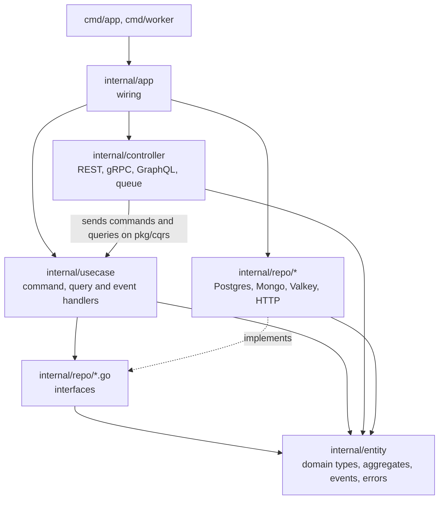

import RepoCode from "../../../components/RepoCode.astro";

The service follows Clean Architecture: the domain sits in the middle, and everything that talks to
the outside world (HTTP, gRPC, SQL, NATS, SMTP) sits around it. On top of that, writes and reads
are separate messages (CQRS) and every change is stored as an event; see
[CQRS and event sourcing](/go-clean-template/concepts/cqrs/).

## The layers

| Layer          | Folder                      | What it owns                                                                                                                                   |
| -------------- | --------------------------- | ---------------------------------------------------------------------------------------------------------------------------------------------- |
| Entity         | `internal/entity`           | The read shapes the API returns, aggregates and their events, claims and sentinel errors. Imports nothing else from the module.                |
| Use case       | `internal/usecase/<domain>` | One file per command, query or event handler, and `register.go`, which puts the handlers on the buses.                                         |
| Ports          | `internal/repo/*.go`        | The interfaces handlers call: the event store, each domain's read model, outbound services.                                                    |
| Adapters       | `internal/repo/<impl>/`     | What implements the ports: the Postgres event store, read models and projectors, MongoDB stores, the Valkey limiter, HTTP clients, the mailer. |
| Controllers    | `internal/controller`       | Each transport, one folder per domain, one file per operation. They build a message and send it.                                               |
| Wiring         | `internal/app`              | Builds everything and starts the servers. The only place that knows every concrete type.                                                       |
| Infrastructure | `pkg/`                      | Reusable pieces with no domain knowledge: the buses, servers, broker, Postgres, Valkey, Mongo, JWT, tracing. Never imports `internal/`.        |

There are no use-case interfaces. A controller does not call a service; it sends a command or a
query on the buses from `pkg/cqrs`, and the handler registered for that message answers. Every
message passes the same pipeline steps (trace, log, metrics, authorize, validate, and for commands
wait and retry), so a handler holds only its own logic.

## Why it is built this way

- **The domain rules have one home.** A rule such as a task's status transitions lives on the
  aggregate. REST, gRPC, GraphQL and the queue worker all send the same command, so none of them
  can skip it.
- **The edges are replaceable.** A handler depends on an interface in `internal/repo`, so you can
  swap Postgres for something else, or test the handler with an in-memory store, without touching
  it.
- **Adding a transport costs only the transport.** A new transport is a set of controllers that
  send messages that already exist.
- **Reads and writes scale apart.** Writes go through aggregates and the event store; reads come
  from read models the worker keeps up to date.

## Wiring happens once

`internal/app` describes each domain as a `module`: what both binaries may build for it. Each
binary takes only the parts it runs. The app takes the handlers, importer, REST and gRPC
registration; the worker takes the projector, event handlers and queues.

<RepoCode path="internal/app/modules.go" symbol="module" />

Each domain fills one in, in its own file:

<RepoCode path="internal/app/task.go" symbol="taskModule" />

`modules()` in `internal/app/modules.go` lists them all. Apart from the GraphQL root resolver,
that is the only list of domains in the code, so adding a domain changes one line there.

Every long-running part (the HTTP and gRPC servers, the projection runner, the queue consumer) is a
`Run(ctx) error` under one errgroup, on the context the binary's `main` cancels on a signal.
Nothing below `main` exits the process.

Read on: [the dependency rule](/go-clean-template/concepts/dependency-rule/) says which of these
arrows are allowed, and [where code goes](/go-clean-template/concepts/where-code-goes/) helps you
pick a layer.
