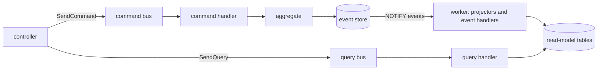

import RepoCode from "../../../components/RepoCode.astro";
import { Aside } from "@astrojs/starlight/components";

Every domain splits its use cases into **commands**, which change state, and **queries**, which
read it. The state is **event-sourced**: what is stored for good is the list of events each
aggregate recorded. The tables queries read are **projections** of those events, which the worker
keeps up to date ([Projections](/go-clean-template/concepts/projections/)).

## Vocabulary

| Term      | Meaning                                                                                        |
| --------- | ---------------------------------------------------------------------------------------------- |
| Command   | A request to change state (`CreateTask`). One handler. Answers only what identifies the write. |
| Query     | A request to read state (`GetTask`). One handler, which reads only a read model.               |
| Event     | A fact that happened (`TaskCreated`). Past tense, never changed once stored.                   |
| Aggregate | The write-side object that checks a command's rules and records events (`TaskAggregate`).      |
| Stream    | One aggregate's events in order, such as `task-<id>`. Its length is the aggregate's version.   |
| Position  | An event's place in the whole store, increasing across every stream.                           |
| Claim     | A unique value (an email, a username) reserved in the same transaction as the events.          |

## Messages and the buses

A message is a plain struct that embeds `cqrs.Command[R]` or `cqrs.Query[R]`, where `R` is what it
answers. The marker types live in `pkg/cqrs`:

<RepoCode path="pkg/cqrs/cqrs.go" symbol="Command" />

`cqrs.SendCommand(ctx, cmds, cmd)` and `cqrs.SendQuery(ctx, qs, q)` find the one handler registered
for the message's type, run the message through the bus's steps, and return an `R`. The compiler
checks the result type, so a handler that answers the wrong type does not build.

<RepoCode path="pkg/cqrs/bus.go" symbol="SendCommand" />

- There is no discovery by reflection. Each domain registers its handlers in
  `internal/usecase/<domain>/register.go`, one line each.
- A message with no handler fails with `cqrs.ErrNoHandler` the first time it is sent.
- A second handler for the same type panics at startup.
- The command bus and the query bus are different types, so a query cannot be sent where a command
  belongs.

## Pipeline steps

Cross-cutting concerns are steps that wrap every message, not decorators around each handler. A step
has this shape:

<RepoCode path="pkg/cqrs/cqrs.go" symbol="Step" />

`newBuses` in `internal/app/buses.go` builds both buses. Each binary calls it once: the app passes
the sign-in limit as an extra step, the worker passes none.

<RepoCode path="internal/app/buses.go" symbol="newBuses" />

The steps, outermost first:

| Step      | Commands | Queries | What it does                                                                            |
| --------- | -------- | ------- | --------------------------------------------------------------------------------------- |
| trace     | yes      | yes     | one span per message, named `command CreateTask`                                        |
| log       | yes      | yes     | the outcome and duration, at debug                                                      |
| metrics   | yes      | yes     | `cqrs_messages_total` and `cqrs_message_duration_seconds`                               |
| stamp     | yes      | yes     | puts the actor (`ActorID()`) and the message name into the event metadata               |
| limit     | yes      | yes     | app only, for a `behavior.Limited` message (`RegisterUser`, `LogIn`): the sign-in limit |
| wait      | yes      |         | after the handler, waits until the projectors of what it wrote have caught up           |
| retry     | yes      |         | runs the handler again on `entity.ErrConcurrencyConflict`, three attempts in all        |
| authorize | yes      | yes     | refuses an `AdminOnly()` message from a non-admin with `entity.ErrAdminRequired`        |
| validate  | yes      | yes     | calls the message's `Validate()` when it has one                                        |

A handler carries none of these concerns, so it cannot forget one. The wait and retry steps are
described in [Projections](/go-clean-template/concepts/projections/).

## Commands

One file per command in `internal/usecase/<domain>/command/`, holding the command type and its
handler. A handler is a struct whose exported fields are its dependencies:

<RepoCode path="internal/usecase/task/command/transition_task.go" symbol="TransitionTask" />

The handler loads the aggregate, calls a behavior method on it and saves what it recorded. It
answers `entity.Written`: the aggregate's ID and the position of its last event. It never answers
the resource. A transport that returns the resource sends a query next: REST `POST /v1/tasks` sends
`CreateTask`, then `GetTask` with the returned ID.

The helpers in `internal/usecase/aggregate` do the store work:

- `aggregate.Save` saves a new or loaded aggregate and answers `Written`.
- `aggregate.Load[entity.TaskAggregate](ctx, store, id)` loads one by ID. The aggregate type knows
  its stream name (`StreamOf`) and its not-found error (`NotFound`).
- `aggregate.Change` loads, runs your change function and saves, in one call.
- `aggregate.Now` is the time in UTC, from a clock tests can fix.

<RepoCode path="internal/usecase/aggregate/aggregate.go" symbol="Change" />

## Queries

One file per query in `internal/usecase/<domain>/query/`. A query reads its domain's read model
(`repo.TaskReadModel`, …) and nothing else; it never loads an aggregate. A read model returns a
record by its ID whoever owns it, and the handler then asks the record's `ReadableBy(userID)`, so
the ownership rule lives in the entity, not in SQL.

<Aside title="The one write outside an aggregate">
  A task's attributes (priority, estimate, labels) live in MongoDB. `SetTaskAttributes` writes them
  directly, records no event and so waits for nothing. They have no history and no projector
  rebuilds them. Use that shape only for data whose history nobody needs.
</Aside>

## Aggregates and events

Aggregates and their events live in `internal/entity`, next to the read shapes the API returns.

| Aggregate             | Stream                    | Events                                                                                    | Projector  | Tables                     |
| --------------------- | ------------------------- | ----------------------------------------------------------------------------------------- | ---------- | -------------------------- |
| `TaskAggregate`       | `task-<uuid>`             | `TaskCreated`, `TaskUpdated`, `TaskTransitioned`, `TaskDeleted`, `TaskImported`           | `task`     | `tasks`                    |
| `UserAggregate`       | `user-<uuid>`             | `UserRegistered`, `UserRegisteredViaOIDC`, `UserImported`                                 | `user`     | `users`, `user_identities` |
| `PasskeyAggregate`    | `passkey-<credential id>` | `PasskeyRegistered`, `PasskeyRenamed`, `PasskeyUsed`, `PasskeyDeleted`, `PasskeyImported` | `passkey`  | `webauthn_credentials`     |
| `ConversionAggregate` | `conversion-<uuid>`       | `CurrencyConverted`, `ConversionImported`                                                 | `exchange` | `exchange_history`         |

- **An aggregate records and applies events.** It embeds `entity.AggregateBase`. A behavior method
  checks the rule and calls `entity.Record`, which applies the event and queues it for the store.
  `Apply` changes the state for one event, the same way whether the event is new or replayed.

  <RepoCode path="internal/entity/task_aggregate.go" symbol="Transition" />

- **An aggregate keeps only what its rules need.** `TaskAggregate` keeps the owner and the status,
  not the title. The read shapes (`entity.Task`, `entity.User`, …) are separate, so renaming an API
  field changes no stored event.
- **Every event type is registered.** Each domain lists its events (`entity.TaskEvents()`), and
  `entity.EventTypes()` joins the lists. The codec decodes only those types, so an unknown event
  fails to load.

  <RepoCode path="internal/entity/event.go" symbol="EventTypes" />

## The event store

The Postgres event store (`internal/repo/persistent/eventstore`) is three tables: `events`,
`snapshots` and `claims`. `Save` appends an aggregate's pending events in one transaction, joining
the transaction the context carries:

<RepoCode path="internal/repo/persistent/eventstore/eventstore.go" symbol="Save" />

1. **Take the store's advisory lock.** Appends run one at a time, so positions commit in the order
   they were assigned. Without it, a projector could pass a position whose earlier neighbour commits
   later, and never see that event.
2. **Check the stream's version** against the version the aggregate was loaded at. A mismatch is
   `entity.ErrConcurrencyConflict`, which the retry step retries.
3. **Insert the claims and the events.** The event row holds its type, schema version, JSON payload
   and metadata (the user, the trace ID as correlation ID, the message as causation ID).
4. **Save a snapshot** when one is due.
5. **`NOTIFY events`**, which Postgres delivers to the worker when the transaction commits.

`Load` reads the latest usable snapshot, then the events after it.

### Claims

Uniqueness across records (emails, usernames, SSO identities) is not a unique index on a read
model: read models lag behind and belong to their projector. It is a claim, saved in the same
transaction as the events:

<RepoCode path="internal/entity/aggregate.go" symbol="Claim" />

A claim another owner holds fails the save with that claim's `Taken` error, such as
`entity.ErrUserAlreadyExists`, so the domain keeps its own error.

### Snapshots

An aggregate that is loaded (task, passkey) implements `entity.Snapshotter`. The store saves its
state as JSON every `EVENTSTORE_SNAPSHOT_EVERY` events, so loading a long stream replays only the
events after it. A field added to the state reads as its zero value from an older snapshot. A change
that cannot read the old shape raises `SnapshotVersion()`; older snapshots are then ignored and the
stream is replayed.

### Upcasting

Stored events are never rewritten. Each event type has a `SchemaVersion()`. To change an event's
shape, raise its version and add an `entity.Upcast` from the previous version to `entity.Upcasts()`;
the codec upgrades old payloads one version at a time as they load.

<RepoCode path="internal/entity/event.go" symbol="Upcast" />

`internal/repo/eventcodec/testdata/events/` holds one frozen sample per event type and version. The
codec tests fail when an event's current shape drifts from its sample, or when an old sample no
longer decodes. Keep the old sample when you add a version.

### Scratch streams

A stream whose ID starts with `_` is stored and loadable but never delivered to a subscriber. The
event store's own integration tests write only scratch streams, so they share the database with a
running worker without disturbing it.

## Configuration

| Variable                    | Default | Effect                                                  |
| --------------------------- | ------- | ------------------------------------------------------- |
| `CQRS_CONSISTENCY_TIMEOUT`  | `2s`    | how long a command waits for its projectors             |
| `EVENTSTORE_SNAPSHOT_EVERY` | `100`   | events between snapshots                                |
| `PROJECTION_POLL_INTERVAL`  | `1s`    | how often the worker polls when no notification arrives |
| `PROJECTION_BATCH_SIZE`     | `100`   | events a subscriber reads at a time                     |

See [Configuration](/go-clean-template/reference/configuration/) for every setting, and
[A request, end to end](/go-clean-template/concepts/request-flow/) for one command and one query
followed through each layer.
