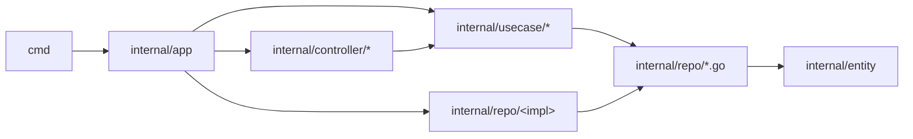

import { Aside } from "@astrojs/starlight/components";
import RepoCode from "../../../components/RepoCode.astro";

Imports point inward, toward the domain. An inner layer never imports an outer one.

## What may import what

| Package                                       | May import                                                                                                                               | Never imports                                                    |
| --------------------------------------------- | ---------------------------------------------------------------------------------------------------------------------------------------- | ---------------------------------------------------------------- |
| `internal/entity`                             | the standard library and small libraries such as `shopspring/decimal`                                                                    | anything else in the module                                      |
| `internal/usecase/<domain>`                   | `entity`, the port interfaces in `internal/repo`, `pkg/`                                                                                 | controllers, `internal/app`, a concrete repository (tests aside) |
| `internal/repo/<impl>`                        | `entity`, the ports, `pkg/`                                                                                                              | use cases, controllers, `internal/app`                           |
| `internal/controller/<transport>/v1/<domain>` | its domain's `command` and `query` packages (for the message types only), `entity`, its transport's shared packages, `authn`, `pkg/cqrs` | repositories, another domain folder, another transport           |
| `pkg/<name>`                                  | the standard library and third-party packages                                                                                            | anything under `internal/`                                       |
| `internal/app`                                | everything                                                                                                                               | (nothing imports it except `cmd/`)                               |

Two shared controller packages are the exceptions among controllers:
`internal/controller/authn` (the caller read from a token), which every transport imports and
which imports no transport, and `internal/controller/httpmw` (the middleware around every HTTP
request).

A use case sees its storage only through an interface it owns:

<RepoCode path="internal/repo/task.go" symbol="TaskReadModel" />

The Postgres package implements it, and only `internal/app` connects the two:

<RepoCode path="internal/repo/persistent/task/task.go" symbol="NewReadModel" />

The handler receives the interface through the exported fields of its domain's `Deps`:

<RepoCode path="internal/usecase/task/register.go" symbol="Deps" />

## Why

- **The domain does not change when the plumbing does.** Swapping a driver, a broker or a transport
  touches the outer ring only.
- **Tests stay small.** A command handler runs against the in-memory event store, a query handler
  against a generated mock of its read model. Neither starts a database.
- **Each package can be read alone.** An entity file tells you the rules without any SQL or HTTP
  in sight.

## How it is kept

<Aside type="caution">
  No linter checks these arrows. The rule holds because of the points below and code review, so
  check your imports before you push.
</Aside>

- **Import cycles do not compile.** Go refuses a cycle, so once `usecase` imports `entity`,
  `entity` can never import `usecase`; the same holds for every pair of layers that already depend
  on each other.
- **Interfaces live with their consumer.** The port is in `internal/repo`, not next to its
  implementation, so a handler has nothing concrete to import.
- **Wiring is in one place.** Only `internal/app` constructs repositories and passes them in, so
  an import of a concrete repository anywhere else stands out in a diff.
- **`internal/` is private to the module.** Go itself stops code outside the module from importing
  it, and `pkg/` is written to be usable on its own.
- **The generator writes the right shape.** `make new-domain` and `make new-usecase` produce code
  that follows the rule on every layer, so new domains start correct.

Next: [where code goes](/go-clean-template/concepts/where-code-goes/).
