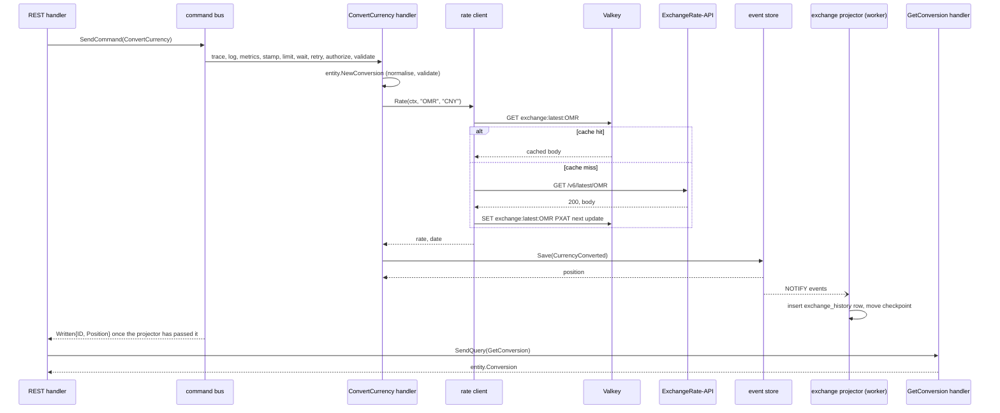

import RepoCode from "../../../components/RepoCode.astro";

This page follows one request through every layer of the template:

```http
POST /v1/exchange/convert
Authorization: Bearer <token>
Content-Type: application/json

{"from": "omr", "to": "CNY", "amount": "100"}
```

```json
{
  "from": "OMR",
  "to": "CNY",
  "amount": "100",
  "rate": "17.406483",
  "result": "1740.65",
  "rate_date": "2026-10-19"
}
```

The exchange domain is the example because it touches every kind of dependency: an inbound
transport, a domain rule, an outbound HTTP API with a cache in front of it, the event store and a
projection. The other domains follow the same path with fewer stops.



## 1. Wiring

Nothing below builds its own dependencies. The exchange module in `internal/app/exchange.go`
registers the domain's handlers on the buses, with the event store, the rate client (with a Valkey
cache) and the read model; and it registers the REST and gRPC controllers, which get the buses and
nothing else:

<RepoCode path="internal/app/exchange.go" symbol="exchangeModule" />

Every dependency a handler holds is an interface from `internal/repo`: `repo.EventStore`,
`repo.ExchangeWebAPI` and `repo.ExchangeReadModel`. That is what lets unit tests hand it the
in-memory store and mocks instead.

## 2. Middleware and auth

The app's chi mux (`internal/app/http.go`) wraps the request in the `internal/controller/httpmw`
middleware: the client address, the request log, the tracing span, metrics, and panic recovery. Then
Huma matches the operation. The operation declares `Security`, so REST's `Auth` middleware requires
`Authorization: Bearer <token>`, turns the token into the caller with `authn.ReadToken`, and
otherwise answers 401.

## 3. Decode (Huma)

The operation lives in its own file in the domain folder. Its input wraps a transport-local DTO
from `request.go`:

<RepoCode path="internal/controller/restapi/v1/exchange/request.go" symbol="Convert" />

Huma decodes the body and checks the tags before your handler runs; a body that fails them gets a
422 problem naming the field. The same tags generate the OpenAPI document and the web client's
types. The tags check only the shape. Whether `"omr"` and `"OMR"` are the same currency is a domain
rule, in the entity.

`Amount` is a string on purpose: a JSON number would pass through a `float64`, and money never does.
It stays a string until the entity parses it into a `decimal.Decimal`.

## 4. The handler

<RepoCode path="internal/controller/restapi/v1/exchange/convert_currency.go" symbol="convert" />

The same steps as every handler on every transport:

1. Read the caller with `authn.MustCaller(ctx)`. The `Auth` middleware already refused a request
   without a token.
2. Build the command from the DTO's fields and send it with Huma's `ctx`.
3. Map any error with `apierr.Problem`.
4. Send a query for the result, because a command answers only `entity.Written`, never the
   resource. Every body a client sees was read from the read model, as its next request will be.
5. Turn the entity into the response DTO (`NewConversion` in `response.go`), which writes each
   decimal as a string.

## 5. The command bus

`SendCommand` finds the handler registered for `ConvertCurrency` and runs the message through the
steps from `newBuses` ([CQRS and event sourcing](/go-clean-template/concepts/cqrs/#pipeline-steps)).
Here the stamp step writes the user ID and `command ConvertCurrency` into the event metadata; limit,
authorize and validate let it through (it is not limited, needs no role and has no `Validate`); and
the wait step holds the answer back until the projector has caught up (step 9).

## 6. The command handler

<RepoCode path="internal/usecase/exchange/command/convert_currency.go" symbol="Handle" />

The rules belong to the entity (`internal/entity/exchange.go`):

<RepoCode path="internal/entity/exchange.go" symbol="NewConversion" />

- `NewConversion` uppercases and trims the codes and parses the amount, once for every transport.
  gRPC has no Huma tags, so this is the check that protects it. A bad pair is
  `ErrInvalidConversion`; a bad amount `ErrInvalidAmount`.
- It runs before the rate lookup, so a bad request never costs a call to the provider.
- `ApplyRate` rounds the result half to even.
- `NewConversionAggregate` (`internal/entity/exchange_aggregate.go`) records one `CurrencyConverted`
  event in the stream `conversion-<id>`.

## 7. The rate client and its cache

`internal/repo/webapi/exchange_openerapi.go` implements `repo.ExchangeWebAPI` against the
ExchangeRate-API open endpoint, `GET {EXCHANGE_SERVICE_URL}/v6/latest/<base>`:

<RepoCode path="internal/repo/webapi/exchange_openerapi.go" symbol="Rate" />

- **Errors arrive as HTTP 200.** The provider reports `{"result": "error"}` with status 200, so the
  client checks `result`. `unsupported-code`, or a target missing from `rates`, is
  `entity.ErrUnsupportedCurrency` (400). Every other provider failure (unreachable, timeout, another
  status, a body that does not decode) is `entity.ErrRatesUnavailable` (502).
- **Rates never touch a float.** The response decodes into `map[string]decimal.Decimal`.
- **The date is the provider's** last update, truncated to a UTC day.
- **One deadline** (`webapi.Timeout`) bounds the whole lookup: cache read, request and cache write.

The cache sits in front of the request:

<RepoCode path="internal/repo/webapi/exchange_openerapi.go" symbol="latest" />

- The key is `exchange:latest:<base>`. A hit decodes exactly like a fresh body.
- On a miss, a successful body is stored byte for byte with `SET … PXAT`, expiring at the
  provider's next update. Error bodies and bodies whose next update has passed are never stored.
- The cache fails open: a read that errors or takes over 500 ms is a miss.
- The `Cache` interface is declared in this package, beside its only consumer, and
  `pkg/valkey.Cache` satisfies it. The command handler knows nothing about it.

## 8. The event store

`aggregate.Save` calls the Postgres event store's `Save`, which in one transaction takes the store's
advisory lock, checks the stream's version (zero, a new stream), inserts the event with its
metadata, and sends `NOTIFY events`, delivered when the transaction commits:

<RepoCode path="internal/repo/persistent/eventstore/eventstore.go" symbol="Save" />

## 9. The projector, and the wait

In the worker, the notification wakes the exchange projector's loop. It reads the events after its
checkpoint and hands `CurrencyConverted` to `project`, which inserts the `exchange_history` row in
the same transaction that moves the checkpoint:

<RepoCode path="internal/repo/persistent/exchange/projector.go" symbol="project" />

Meanwhile, the app's wait step polls `projection_checkpoints`. Once the exchange projector is at or
past the command's position, `SendCommand` returns. If it is still behind after
`CQRS_CONSISTENCY_TIMEOUT`, the client gets a 503: the conversion is saved, but a read could still
miss it. See [Projections](/go-clean-template/concepts/projections/).

## 10. The query

`SendQuery(GetConversion)` runs through the query bus's steps to its handler, which reads the row
from the read model and asks the conversion whether the caller may read it. Another user's
conversion is `ErrConversionNotFound`, exactly as a missing one is. A query never touches the event
store.

<RepoCode path="internal/usecase/exchange/query/get_conversion.go" symbol="Handle" />

## Where each failure ends up

| What went wrong                                     | Caught by                                      | REST |
| --------------------------------------------------- | ---------------------------------------------- | ---- |
| No token, or an expired one                         | `Auth` middleware                              | 401  |
| Code not three letters, amount not a decimal string | Huma tags on `Convert`                         | 422  |
| `from` equal to `to`                                | `entity.NewConversion`: `ErrInvalidConversion` | 400  |
| Amount not positive, or too many digits             | `entity.NewConversion`: `ErrInvalidAmount`     | 400  |
| A currency the provider does not know               | rate client: `ErrUnsupportedCurrency`          | 400  |
| Provider down, slow, or answering garbage           | rate client: `ErrRatesUnavailable`             | 502  |
| Saved, but the projector did not catch up in time   | wait step: `ErrReadModelBehind`                | 503  |
| A database error                                    | wrapped error, logged                          | 500  |

The caller sees only the sentinel's message (`"unsupported currency"`) or `"internal server
error"`. The wrapped error with its layer path goes to the log. See
[Errors](/go-clean-template/concepts/errors/).

## The same command over gRPC

`internal/controller/grpc/v1/exchange/convert.go` does the same steps with the generated request
type, `rpcerr.Status` for errors and `NewConversionResponse` for the answer. It sends the identical
`ConvertCurrency` and `GetConversion`, so the transports cannot disagree about a rule. GraphQL
exposes only the history query, `exchangeHistory`.

## How each layer is tested

| Layer           | Test                                                             | What stands in for the layer below                                   |
| --------------- | ---------------------------------------------------------------- | -------------------------------------------------------------------- |
| Entity          | `internal/entity/exchange_test.go`, `exchange_aggregate_test.go` | nothing                                                              |
| Command handler | `internal/usecase/exchange/command/convert_currency_test.go`     | `memstore` and a gomock rate client                                  |
| Query handlers  | `internal/usecase/exchange/query/query_test.go`                  | a gomock read model                                                  |
| Projector       | `internal/repo/persistent/exchange/projector_test.go`            | a fake sqlc `Querier`                                                |
| Rate client     | `internal/repo/webapi/exchange_openerapi_test.go`                | an `httptest` server replaying a recorded response, and a fake cache |
| Whole stack     | `integration-test/exchange_test.go`                              | a stub serving the same recorded response                            |

See [Testing](/go-clean-template/concepts/testing/).
