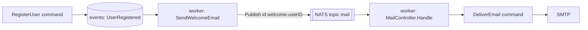

import { Aside, Steps } from "@astrojs/starlight/components";
import RepoCode from "../../../components/RepoCode.astro";

An event handler does something _because_ an event happened: it sends an email, captures an
analytics event, calls another system. It never changes the domain's own state; that is a
command's job. Handlers run in the worker, beside the projectors, on the same loop: each event of
a type the handler handles is passed to it, and its checkpoint moves only after it succeeds.

Commands do not wait for event handlers. A slow or failing handler delays its side effect, never
the request. See [projections](/go-clean-template/concepts/projections/) for how the loop works.

The worked example is `send-welcome-email`: when a user registers with a password, the worker
publishes a welcome email to the `mail` queue, and a queue handler delivers it.



## Steps

<Steps>

1. **Write the handler** in `internal/usecase/<domain>/event/<name>.go`. It is a
   `repo.Subscriber`: a `Name` (its checkpoint's name, unique across the worker), `Handles` (the
   event types it receives) and `Handle`. Its dependencies are exported fields, filled in by the
   module.

   <RepoCode path="internal/usecase/user/event/send_welcome_email.go" symbol="SendWelcomeEmail" />
   <RepoCode path="internal/usecase/user/event/send_welcome_email.go" symbol="Handle" />

   Type-assert the event and return `entity.ErrUnhandledEvent` for anything else. Wrap every
   error with the layer path; a returned error is retried.

2. **Reach the outside world through a port.** The handler calls `repo.UserNotifier`, not the
   broker. The implementation in `internal/repo/notify` publishes through `notify.Publisher`, a
   port that `*broker.Broker` satisfies:

   <RepoCode path="internal/repo/notify/notify.go" symbol="Publisher" />

   Give every publish an ID **derived from the event**. The worker can crash after the publish but
   before its checkpoint moves; it then handles the same event again. JetStream drops a second
   message with the same ID inside its duplicate window, so the user still gets one email:

   <RepoCode path="internal/repo/notify/notify.go" symbol="Welcome" />

3. **Return it from the module.** In `internal/app/<domain>.go`, the module's `eventHandlers`
   builds the handler from the shared dependencies. Only the worker installs event handlers.

   <RepoCode path="internal/app/user.go" symbol="userModule" />

4. **Consume the queue, if you published to one.** A queue handler lives in
   `internal/controller/worker/v1/<name>.go`. It decodes the message, sends a command on the
   worker's buses and returns its error. It is registered by a module's `queues` function.

   <RepoCode path="internal/controller/worker/v1/mail.go" symbol="Handle" />- Returning `nil`
   acknowledges the message. - Returning an error retries it with exponential backoff
   (`WORKER_MAX_RETRIES`, `WORKER_RETRY_INITIAL`, `WORKER_RETRY_MAX`); after the last retry the
   message moves to the `poison` topic and is logged at `Error`. - Returning `broker.Permanent(err)`
   sends it to `poison` at once. Use it for a message that can never succeed, such as a body that
   does not decode.

5. **Test it.** Test the handler beside it with a mock of its port
   (`send_welcome_email_test.go`), and the queue handler in `internal/controller/worker/v1`. Then
   run the checks:

   ```sh
   make format
   make linter-golangci
   make test
   ```

6. **Run it.** `make dev` starts the worker with the app. Register a user and the email arrives in
   Mailpit (see [add an email](/go-clean-template/guides/email/)).

</Steps>

<Aside type="caution">
  An event handler cannot be rebuilt. `make projection-rebuild` accepts only projector names:
  replaying a handler would repeat its side effects, such as sending every welcome email again. A
  new handler starts from the first event unless it says otherwise (`CaptureUser` implements
  `StartsAtHead` to start from the newest one).
</Aside>

## Rules

- A handler only causes side effects and never writes another domain's read model: projectors own their tables.
- It calls a port, never the broker or an SDK directly, so it stays testable and the transport can change.
- Every publish carries an ID derived from the event, because the handler can run twice for one event.
- A queue handler is idempotent: delivery is at-least-once.
- A message that can never succeed returns `broker.Permanent(err)`; never `return nil` to drop it, or it is lost without a trace.
- Only the worker publishes; a command in the app has no broker.
- Handlers are not rebuilt, so do not design one that needs replaying to be correct.
