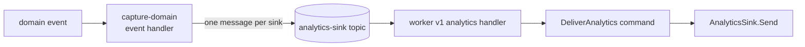

import { Aside } from "@astrojs/starlight/components";
import RepoCode from "../../../../components/RepoCode.astro";

Analytics is optional. With no vendor configured, nothing is captured and nothing else changes. The
template stores no analytics itself; a vendor (PostHog today) does. No event carries an email, a
name, task text or an amount: the event types have no field for them.

## How it is enabled

| Side                | On when                                 | Settings                                                               |
| ------------------- | --------------------------------------- | ---------------------------------------------------------------------- |
| Server (the worker) | `POSTHOG_API_KEY` is set                | `POSTHOG_API_KEY`, `POSTHOG_HOST` (default `https://eu.i.posthog.com`) |
| Web client          | `VITE_POSTHOG_KEY` is set at build time | `VITE_POSTHOG_KEY`, `VITE_POSTHOG_HOST`                                |

There is no on/off switch: a vendor is on when its key is present. See
[configuration](/go-clean-template/reference/configuration/).

<RepoCode path="internal/app/analytics.go" symbol="analyticsSinks" />

With no sink, the `capture-*` event handlers are not installed at all.

## What is sent

| Event                     | Sent by | Source                               | Properties                                        |
| ------------------------- | ------- | ------------------------------------ | ------------------------------------------------- |
| `user_registered`         | worker  | a user registered (password or OIDC) | `method`                                          |
| `task_created`            | worker  | `TaskCreated`                        | none                                              |
| `task_status_changed`     | worker  | `TaskTransitioned`                   | `from`, `to`                                      |
| `currency_converted`      | worker  | `CurrencyConverted`                  | `from`, `to` (currencies, not the amount)         |
| `user_logged_in`          | web     | a successful sign-in                 | `method` (`password`, `passkey`, `oidc`)          |
| `task_attributes_updated` | web     | the attributes mutation succeeded    | `fields` (names, not values)                      |
| `page_viewed`             | web     | every route change                   | `path` (the route template, such as `/tasks/$id`) |

The server's events are typed in `internal/entity/analytics`, one file per domain, listed by
`Events()`. The web's names are in `web/src/lib/analytics-events.ts`. The distinct ID is the user ID
on both sides, so server and web events join. A sink maps the template's names to its vendor's.

## How a server event travels

- **No outbox.** Only events that follow a stored event are sent from the server; the event store is
  the delivery guarantee. Sign-in is a query and task attributes have no event, so the web client
  captures those two.
- **No history.** The `capture-*` handlers start at the head of the store the first time they run
  (`repo.StartsAtHead`), so turning a vendor on for a database with history sends none of it.
  `*Imported` events are never mapped.
- **Once per vendor.** An event's ID is `<stream id>-<stream version>`, the same on every replay. The
  sink turns it into its vendor's dedup key.
- **One topic per sink.** A vendor that is down retries and goes to `poison` alone. An event the
  vendor refuses (`analytics.ErrRejected`, a 4xx) goes to `poison` at once. See the
  [worker](/go-clean-template/reference/features/worker/).

<RepoCode path="internal/entity/analytics/analytics.go" symbol="EventID" />

## The web client

`web/src/lib/analytics.ts` is the only file that imports `posthog-js`; `make web-check` enforces
it. Without `VITE_POSTHOG_KEY` it loads nothing. It sends page views with the route template,
identifies the user by ID after sign-in and resets on sign-out. Autocapture and PostHog's own page
views are off. Session replay masks every input and all text.

## Adding or replacing a vendor

A sink is a `repo.AnalyticsSink` (`Name`, `Send`) in `internal/repo/analytics/<vendor>/`, the only
package that knows its vendor. Several sinks can be on at once.

1. Write the sink. It sends one event per call and waits for the answer, so a failure reaches the
   queue; a refusal is `analytics.ErrRejected`. Test it with `sinktest.Run` against a fake vendor.
2. Add its settings section in `config/analytics.go`, `.env.example` and the compose `environment`.
3. Add one `if` in `analyticsSinks` that builds it when its settings are set.

A vendor added later receives events from the moment it is configured.

<Aside>
  There is no consent banner, GDPR delete, person properties, surveys or experiments. Add them for
  your own product if you need them.
</Aside>
