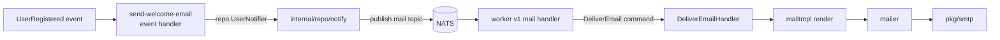

import { Aside } from "@astrojs/starlight/components";
import RepoCode from "../../../../components/RepoCode.astro";

Email is asynchronous and only the worker sends it. The template ships one email, the welcome email
a user gets after registering with a password. Users created by an SSO sign-in or imported by the
backfill get none.

## The pipeline

1. **Event handler.** `send-welcome-email` (`internal/usecase/user/event`) reacts to a registration
   and calls `repo.UserNotifier.Welcome`. It never sees the broker or the encoding.
2. **Publish.** `internal/repo/notify` encodes the email with `entity.EncodeEmail` and publishes it
   on the `mail` topic (`entity.EmailQueue`) with the ID `welcome-<user id>`. If the worker crashes
   before the checkpoint moves, the handler runs again and JetStream drops the duplicate.
3. **Queue handler.** `internal/controller/worker/v1/mail.go` decodes the body with
   `entity.DecodeEmail` and sends the `DeliverEmail` command. Both ends are this codebase, so this
   handler decodes straight into the entity instead of a transport DTO.
4. **Render and send.** The command handler renders through `internal/repo/mailtmpl` and sends the
   `repo.RenderedEmail` through `internal/repo/mailer`, which hands it to `pkg/smtp`.

<RepoCode path="internal/usecase/mail/command/deliver_email.go" symbol="Handle" />

A registration answers before its email is published, and a failed publish is retried with the
event, so a registration never fails because of email. Delivery is at-least-once: an email can
arrive twice if the worker stops between the relay accepting it and the message being acknowledged.
Retries and the poison topic work as for any queue message; see the
[worker](/go-clean-template/reference/features/worker/).

## Templates

`mailtmpl` renders from Go templates embedded in the binary: the HTML part with `html/template`,
which escapes user data, and the subject and text part with `text/template`.

- `templates/layout/` holds what every email shares: `layout.html.tmpl`, `partials.html.tmpl`
  (`heading`, `paragraph`, `button`, `footnote`) and `layout.txt.tmpl`.
- An email is `templates/<name>.html.tmpl` defining `content`, and `templates/<name>.txt.tmpl`
  defining `subject` and `text`. They execute against the `entity.Email` whose `Template()` returns
  `<name>`.
- The data is a struct in `internal/entity/email_<name>.go`, listed in `EmailTypes()`.
  `DecodeEmail` reads only the listed types.

<RepoCode path="internal/entity/email.go" symbol="Email" />

The render test executes every email against a full and a zero-value fixture and compares the output
with `testdata/<name>.golden.{html,txt}`. To add an email, see
[send an email](/go-clean-template/guides/email/).

## SMTP

`pkg/smtp` is a client on the standard library's `net/smtp`: one connection per message, STARTTLS
when the server offers it, PLAIN auth when a username is set. A message goes out as
`multipart/alternative` (text, then HTML).

## Startup checks

The mail module is built only in the worker, and it fails the worker at startup when a template does
not parse or `MAIL_FROM` is not exactly one address:

<RepoCode path="internal/app/mail.go" symbol="mailModule" />

## Settings

See [configuration](/go-clean-template/reference/configuration/).

| Variable        | Default                                 |                             |
| --------------- | --------------------------------------- | --------------------------- |
| `SMTP_HOST`     | `localhost`                             | the relay                   |
| `SMTP_PORT`     | `1025`                                  | Mailpit's SMTP port         |
| `SMTP_USERNAME` | empty                                   | PLAIN auth when set         |
| `SMTP_PASSWORD` | empty                                   |                             |
| `MAIL_FROM`     | `noreply@example.com` in `.env.example` | the sender, a bare address  |
| `APP_BASE_URL`  | `http://localhost`                      | the base of links in emails |

<Aside>
  `.env.example` is also read by the shell in CI, so `MAIL_FROM` stays a bare address with no
  spaces.
</Aside>

## Mailpit in development

`make compose-up`, `make dev` and the integration stack run Mailpit, which catches every email. Its
inbox is at `http://127.0.0.1:8025` (`MAILPIT_UI_PORT`). Register a user to get one. The
integration tests assert on what reaches it.

## Replacing the provider

`internal/repo/mailer` implements `repo.Mailer` on `pkg/smtp`. To send through a provider's HTTP API
instead, write another `repo.Mailer` and pass it in `mailModule`. The templates and the queue stay
as they are.
