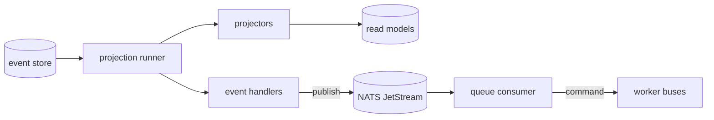

import { Aside } from "@astrojs/starlight/components";
import RepoCode from "../../../../components/RepoCode.astro";

The worker, `cmd/worker`, is a separate binary with two jobs:

- It runs the **projections**: the projectors that keep the read models up to date from the event
  store, and the event handlers that react to events.
- It consumes the **queue**: topics on NATS JetStream, routed by Watermill in `pkg/broker`.

The app needs it. Every write waits for the projectors of what it wrote before it answers (see
[projections](/go-clean-template/concepts/projections/)), so without a worker a write answers
`ErrReadModelBehind` after `CQRS_CONSISTENCY_TIMEOUT`. `make dev` and the compose stack start it;
locally, run `make run-worker`.

## How it starts

`RunWorker` refuses to start without `NATS_URL` (`app.ErrNoNATSURL`), connects the broker, builds
the projection runner, registers each module's queues, and runs the broker and the runner under one
errgroup. Both stop on the same SIGTERM.

<RepoCode path="internal/app/worker.go" symbol="RunWorker" />

The worker never applies the schema; the app does. The worker serves no HTTP and issues no token, so
it starts without `JWT_SECRET`, `VALKEY_URL` or `MONGO_URL`.

## Projections

The runner starts one loop per subscriber: every module's projector and event handlers. Each event
of a type the subscriber `Handles` is handled in one transaction with the move of its checkpoint,
so a read model is updated exactly once. Settings: `PROJECTION_POLL_INTERVAL`,
`PROJECTION_BATCH_SIZE`.

To rebuild one projector's read model, with the worker running, use `make projection-rebuild
name=<projector>`. It empties the tables, resets the checkpoint and notifies the running worker,
which replays every event. Only projectors can be rebuilt: replaying an event handler repeats its
side effects. See [rebuild a projection](/go-clean-template/guides/rebuild-projection/).

## The queue

`pkg/broker` wraps Watermill on NATS JetStream. `New` connects a publisher and a subscriber,
`Publish(ctx, topic, id, body)` sends, `Handle(topic, handler)` registers a route and `Run` serves
until the context ends. A topic is a JetStream stream of the same name, created on first use.

- **Durable consumers and queue groups.** Each topic has a durable consumer in the queue group
  `worker-<topic>`. Several worker replicas share a topic's messages, each message reaching one of
  them, and a restarted worker carries on from the first unacknowledged message.
- **At-least-once.** A handler returning `nil` acknowledges its message. Handlers must be idempotent.
- **Retry with backoff.** A handler that fails or panics is retried in the worker up to
  `WORKER_MAX_RETRIES` times, waiting from `WORKER_RETRY_INITIAL` and doubling up to
  `WORKER_RETRY_MAX`.
- **Poison.** A message still failing after its retries, or one whose handler returns
  `broker.Permanent(err)`, moves to the `poison` topic and is logged at `Error`. It is kept, not
  dropped. Never `return nil` to drop a message that cannot succeed. How poison messages are
  inspected and replayed is not decided yet; the open question is marked by a TODO in `pkg/broker`.
- **Shutdown.** On SIGTERM the router stops taking messages and waits up to
  `WORKER_SHUTDOWN_TIMEOUT` for handlers in flight.

<RepoCode path="pkg/broker/broker.go" symbol="newRouter" />

<Aside type="caution">
  `WORKER_ACK_WAIT` must be longer than a message's handling plus all its retries. Otherwise
  JetStream redelivers it to another worker while the first is still retrying.
</Aside>

### Publish IDs and deduplication

Every publish carries an ID, and JetStream drops a second publish with the same ID inside its
duplicate window. A producer derives the ID from the event it reacts to (the welcome email uses
`welcome-<user id>`), so an event handler that runs again after a crash, before its checkpoint
moved, does not send twice.

### Only the worker connects to NATS

The app never connects to NATS. NATS being down delays email and analytics but never fails a
request. Producers are event handlers, which run in the worker. A command in the app cannot publish;
an outbox for that has not been decided.

## Handlers

Queue handlers live in `internal/controller/worker/v1`, each with a function that registers it,
called by its module's `queues` in `internal/app`. A message is an inbound request, so a handler has
the same shape as an HTTP one: decode the body, send a command on the worker's buses, return its
error.

<RepoCode path="internal/controller/worker/v1/mail.go" symbol="Handle" />

The topics today are `mail` ([email](/go-clean-template/reference/features/email/)) and one
`analytics-<sink>` per configured analytics vendor
([analytics](/go-clean-template/reference/features/analytics/)). To add your own, see
[add an event handler](/go-clean-template/guides/event-handler/).

## Settings

See [configuration](/go-clean-template/reference/configuration/).

| Variable                  | Default                        |                                                         |
| ------------------------- | ------------------------------ | ------------------------------------------------------- |
| `NATS_URL`                | empty (required by the worker) | the JetStream server                                    |
| `WORKER_MAX_RETRIES`      | `5`                            | retries before a message goes to `poison`               |
| `WORKER_RETRY_INITIAL`    | `1s`                           | first backoff                                           |
| `WORKER_RETRY_MAX`        | `30s`                          | backoff cap                                             |
| `WORKER_ACK_WAIT`         | `5m`                           | how long JetStream waits for an ack before redelivering |
| `WORKER_SHUTDOWN_TIMEOUT` | `10s`                          | grace for handlers in flight on shutdown                |

## Replacing the broker

Producers publish through a port of their own (`notify.Publisher`), which `*broker.Broker`
satisfies, and handlers register on a small `Router` interface. Another broker is another
implementation of those two interfaces, built in `internal/app/worker.go`. The projections cannot be
turned off: the app depends on them.
